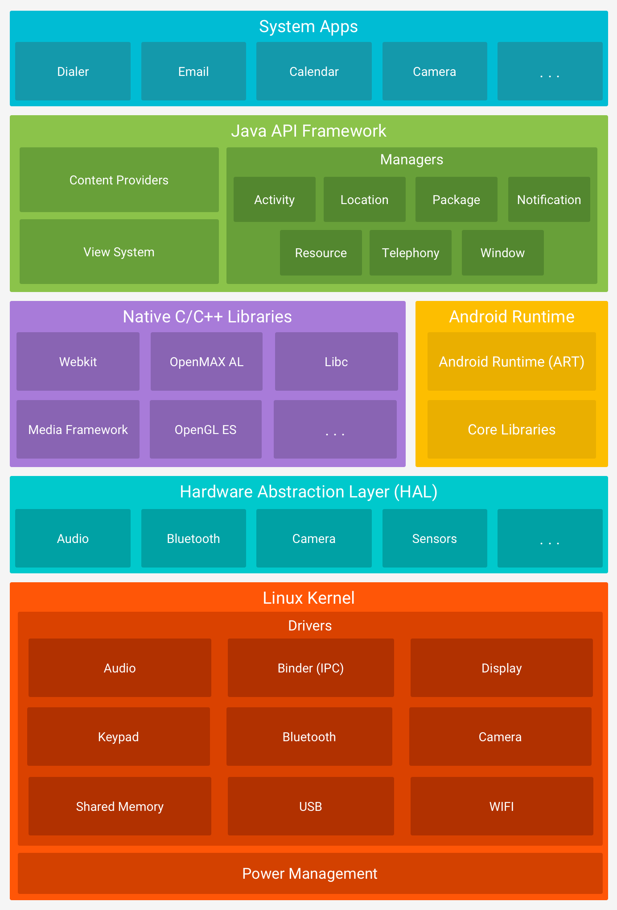

<!-- _class: cover_e -->
<!-- _paginate: "" -->
<!-- _footer:  -->
<!-- _header:  -->

# 第一章 移动应用开发概述与环境搭建

###### “工欲善其事，必先利其器。”

张丽，井明
数据科学与计算机学院
jingming@sdu.edu.cn
2026年秋

---

<!-- _header: 目录<br>CONTENTS<br>-->
<!-- _class: toc_b -->
<!-- _footer: "" -->
<!-- _paginate: "" -->

- [移动应用开发概览](#0)
- [Android 平台体系结构](#0)
- [Kotlin 与 Android](#0)
- [开发环境搭建](#0)
- [第一个 Android 应用](#0)
- [构建与运行原理](#0)

---

## 第一节 移动应用开发概览

- 移动互联网与移动应用形态
- 三种主流开发方式
- Android 与 iOS 生态对比
- 本课程的定位

---

### 移动应用的三种形态

| 形态 | 技术栈 | 特点 |
| --- | --- | --- |
| 原生应用 | Kotlin/Java、Swift/OC | 性能最好，能力最全，需分平台开发 |
| 跨平台应用 | Flutter、React Native、KMP | 一套代码多端运行，受框架能力约束 |
| Web 应用 | HTML/CSS/JS、PWA | 免安装、易更新，系统能力受限 |

> 本课程聚焦 **原生 Android 开发**，语言为 **Kotlin**，UI 框架为 **Jetpack Compose**。

---

### 为什么先学原生

- 原生开发是理解移动平台的**基础**：进程模型、生命周期、权限、渲染
- 跨平台框架最终仍要落到原生能力上（插件、桥接、平台通道）
- 掌握原生后再学 Flutter / KMP，只是换一层语法外壳
- 就业市场对“懂原生的跨平台工程师”需求更高

---

### Android 生态的基本事实

- 全球市场份额长期居于首位，设备形态多样（手机、平板、车机、TV、可穿戴）
- 碎片化：厂商 ROM、屏幕尺寸、系统版本并存 → **兼容性**是常态问题
- 分发渠道多元：Google Play、国内各应用商店、企业分发
- Google 官方推荐技术栈：Kotlin + Jetpack + Compose + Material Design

---

### 本课程的学习路径

```text
Kotlin 语言基础
       ↓
Android 应用骨架
       ↓
   Compose UI
       ↓
  数据与网络
       ↓
架构与系统能力
       ↓
  发布与优化
```

- 每章配套一个实验，理论与动手 1 : 1
- 期末以一个**完整可运行的小型 App** 作为课程设计成果

---

## 第二节 Android 平台体系结构

- 五层体系结构
- ART 与 Dalvik
- API Level 与版本兼容
- 应用沙箱与安全模型

---

<!-- _footer: '' -->

### Android 系统分层




---

### Android Runtime（ART）

- 应用代码编译为 **DEX 字节码**，由 ART 执行
- 混合编译策略：
  - **AOT**：安装或空闲时预编译为机器码
  - **JIT**：运行时热点方法即时编译
  - **Profile-guided**：根据实际使用情况优化
- 相比早期 Dalvik：启动更快、GC 停顿更短、内存占用更优

---

### API Level 与版本兼容

- 每个 Android 版本对应一个 **API Level**（如 Android 14 → API 34）
- 三个关键配置：

```kotlin
android {
    compileSdk = 36        // 用哪套 SDK 编译（通常取最新）
    defaultConfig {
        minSdk = 24        // 最低支持的系统版本
        targetSdk = 36     // 已针对该版本适配（影响运行时行为）
    }
}
```

> `minSdk` 越低覆盖用户越多，但可用 API 越少；`targetSdk` 不升级会触发商店合规限制。

---

### 应用沙箱与安全模型

- 每个应用运行在**独立进程**，拥有独立的 Linux UID
- 应用私有目录（`/data/data/<包名>/`）默认其他应用不可访问
- 跨应用访问必须通过：Intent、ContentProvider、权限声明
- 危险权限必须在**运行时**由用户授权（Android 6.0+）
- 分区存储（Scoped Storage）限制了对公共存储的自由读写

---

### 思考

同一个 APK 装在 Android 8 和 Android 15 的手机上，行为可能完全不同。
请思考：这种差异主要由哪几个因素决定？

---

## 第三节 Kotlin 与 Android

- Kotlin 的由来与定位
- Kotlin-first 的官方策略
- 相比 Java 的关键优势
- 与 Java 的互操作

---

### Kotlin 简介

- JetBrains 于 2011 年发布，2016 年 1.0，2017 年成为 Android 官方支持语言
- 2019 年 Google 宣布 **Kotlin-first**：新 API、新文档、新示例优先 Kotlin
- 运行在 JVM 上，编译为与 Java 相同的字节码
- 支持多目标：Kotlin/JVM、Kotlin/JS、Kotlin/Native、Kotlin Multiplatform

---

### Kotlin 解决了什么问题

| Java 的痛点 | Kotlin 的方案 |
| --- | --- |
| NullPointerException 频发 | 类型系统区分可空 / 非空 |
| 大量样板代码（getter/setter/equals） | `data class`、属性、默认参数 |
| 匿名内部类回调地狱 | Lambda、高阶函数、协程 |
| 工具类膨胀（`StringUtils`） | 扩展函数 |
| 异步代码难写难读 | 协程：以同步写法写异步 |

---

### 一段代码的对比

```java
// Java
public class User {
    private final String name;
    public User(String name) { this.name = name; }
    public String getName() { return name; }
    @Override public String toString() { return "User{name=" + name + "}"; }
    @Override public boolean equals(Object o) { /* ... */ }
    @Override public int hashCode() { /* ... */ }
}
```

```kotlin
// Kotlin
data class User(val name: String)
```

---

### 与 Java 互操作

- Kotlin 可直接调用任意 Java 类库，反之亦然
- 同一模块中 `.kt` 与 `.java` 文件可共存、互相引用
- 平台类型（`String!`）：来自 Java 的值编译器无法判断可空性
- 常用注解：`@JvmStatic`、`@JvmOverloads`、`@JvmField`、`@Nullable/@NonNull`

> 老项目迁移可以**逐文件**进行，不必一次性重写。

---

## 第四节 开发环境搭建

- 所需软件与版本
- JDK 安装与配置
- Android Studio 安装
- 国内镜像与代理配置
- SDK Manager 与 AVD

---

### 所需软件清单

| 软件 | 推荐版本 | 说明 |
| --- | --- | --- |
| JDK | 17 或 21（LTS） | Android Studio 自带 JBR，也可独立安装 |
| Android Studio | 最新稳定版 | 集成 SDK、模拟器、Gradle |
| Android SDK | API 24 ~ 最新 | 通过 SDK Manager 下载 |
| Gradle | 由项目 Wrapper 指定 | 不要手动全局安装 |

国内下载：华为云 OpenJDK 镜像、[developer.android.google.cn/studio](https://developer.android.google.cn/studio)

---

### JDK 安装与验证

1. 下载并安装 JDK 17+（或解压绿色版到无空格、无中文的路径）
2. 配置环境变量（Windows）
   - `JAVA_HOME` = JDK 安装目录
   - `Path` 追加 `%JAVA_HOME%\bin`
3. 验证

```bash
java -version
javac -version
```

> macOS / Linux 在 `~/.zshrc` 中 `export JAVA_HOME=$(/usr/libexec/java_home -v 17)`

---

### Android Studio 安装要点

1. 运行安装程序，选择 “Do not import settings”
2. 安装路径避免系统盘、中文与空格（如 `D:\Android\AndroidStudio`）
3. 组件保持默认：Android Studio + Android Virtual Device
4. 首次启动的 Setup Wizard 会下载 SDK，**此时先配置代理/镜像**
5. SDK 存放路径同样避免中文（如 `D:\Android\Sdk`）

---

### Gradle 国内镜像配置

在用户目录 `.gradle/` 下创建 `init.gradle`（或 `init.gradle.kts`）：

```groovy
allprojects {
    repositories {
        maven { url 'https://maven.aliyun.com/repository/google' }
        maven { url 'https://maven.aliyun.com/repository/central' }
        maven { url 'https://maven.aliyun.com/repository/gradle-plugin' }
        maven { url 'https://mirrors.huaweicloud.com/repository/maven' }
        google()
        mavenCentral()
    }
}
```

> 该文件对**所有项目**生效，是解决“依赖下载卡住”的首选手段。

---

### SDK Manager 与 AVD Manager

- **SDK Manager**（Settings → Languages & Frameworks → Android SDK）
  - SDK Platforms：勾选目标 API 与最低 API
  - SDK Tools：Build-Tools、Platform-Tools、Emulator、Command-line Tools
- **AVD Manager**（Device Manager）
  - 选设备型号（如 Pixel 6）→ 选系统镜像（带 Google APIs）→ Finish
  - x86_64 镜像在 Intel/AMD 上需开启硬件加速；Apple Silicon 选 arm64 镜像

---

### 真机调试

1. 设置 → 关于手机 → 连续点击“版本号” 7 次，开启开发者模式
2. 开发者选项中打开 **USB 调试**
3. USB 连接电脑，手机端确认授权指纹
4. 验证连接

```bash
adb devices
```

> 部分国产 ROM 还需额外打开“USB 安装”“USB 调试(安全设置)”。

---

## 第五节 第一个 Android 应用

- 创建项目
- 工程目录结构
- Gradle 脚本解读
- 运行与调试

---

### 创建项目

1. New Project → **Empty Activity**（Compose 模板）
2. 填写配置
   - Name：`FirstApp`
   - Package name：`com.example.firstapp`
   - Language：Kotlin
   - Minimum SDK：API 24 (Android 7.0)
   - Build configuration language：Kotlin DSL (`.kts`)
3. Finish，等待首次 Gradle Sync 完成

---

### 工程目录结构

```text
FirstApp/
├── app/
│   ├── src/main/
│   │   ├── java/com/example/firstapp/   # Kotlin 源码
│   │   ├── res/                          # 资源：图片、字符串、主题
│   │   └── AndroidManifest.xml           # 应用清单
│   ├── build.gradle.kts                  # 模块级构建脚本
│   └── proguard-rules.pro
├── gradle/libs.versions.toml             # 版本目录
├── build.gradle.kts                      # 项目级构建脚本
└── settings.gradle.kts                   # 模块与仓库配置
```

---

### AndroidManifest.xml

```xml
<manifest xmlns:android="http://schemas.android.com/apk/res/android">
    <application android:label="@string/app_name" android:theme="@style/Theme.FirstApp">
        <activity android:name=".MainActivity" android:exported="true">
            <intent-filter>
                <action android:name="android.intent.action.MAIN" />
                <category android:name="android.intent.category.LAUNCHER" />
            </intent-filter>
        </activity>
    </application>
</manifest>
```

- 声明组件、权限、图标、主题；`LAUNCHER` 决定哪个界面是启动页

---

### 模块级 build.gradle.kts

```kotlin
plugins {
    alias(libs.plugins.android.application)
    alias(libs.plugins.kotlin.android)
    alias(libs.plugins.kotlin.compose)
}
android {
    namespace = "com.example.firstapp"
    compileSdk = 36
    defaultConfig { minSdk = 24; targetSdk = 36; versionCode = 1; versionName = "1.0" }
    buildFeatures { compose = true }
}
dependencies {
    implementation(platform(libs.androidx.compose.bom))
    implementation(libs.androidx.material3)
}
```

---

### 版本目录 libs.versions.toml

```toml
[versions]
kotlin = "2.2.0"
composeBom = "2025.06.00"

[libraries]
androidx-material3 = { group = "androidx.compose.material3", name = "material3" }
androidx-compose-bom = { group = "androidx.compose", name = "compose-bom", version.ref = "composeBom" }

[plugins]
kotlin-android = { id = "org.jetbrains.kotlin.android", version.ref = "kotlin" }
```

> 集中管理依赖版本，避免多模块版本漂移。

---

### MainActivity 长什么样

```kotlin
class MainActivity : ComponentActivity() {
    override fun onCreate(savedInstanceState: Bundle?) {
        super.onCreate(savedInstanceState)
        setContent {
            FirstAppTheme {
                Greeting(name = "Android")
            }
        }
    }
}

@Composable
fun Greeting(name: String) {
    Text(text = "Hello, $name!")
}
```

- `setContent {}` 取代了传统的 `setContentView(R.layout.xxx)`

---

### 运行与调试

- **Run**（Shift+F10）：编译 → 安装 → 启动
- **Debug**（Shift+F9）：断点、单步、变量查看、表达式求值
- **Logcat**：查看日志，按包名/级别过滤

```kotlin
private const val TAG = "MainActivity"
Log.d(TAG, "onCreate called")
```

- **Layout Inspector**：查看运行时 UI 树与属性

---

## 第六节 构建与运行原理

- Gradle 构建流程
- APK 与 AAB
- ADB 常用命令
- 常见问题排查

---

### 从源码到 APK


- **R8**：代码压缩、混淆、优化（release 构建启用）
- **签名**：debug 用本地 debug.keystore，release 必须用自有密钥库

---

### APK 与 AAB

| | APK | AAB (Android App Bundle) |
| --- | --- | --- |
| 用途 | 直接安装、旁加载 | 上传应用商店 |
| 内容 | 全量资源 | 由商店按设备裁剪生成 APK |
| 体积 | 较大 | 用户下载体积更小 |
| 命令 | `assembleRelease` | `bundleRelease` |

> Google Play 已强制要求新应用使用 AAB；国内商店多数仍用 APK。

---

### ADB 常用命令

```bash
adb devices                    # 列出已连接设备
adb install -r app-debug.apk   # 安装/覆盖安装
adb uninstall com.example.app  # 卸载
adb logcat -s MainActivity     # 按 tag 过滤日志
adb shell am start -n com.example.app/.MainActivity   # 启动 Activity
adb shell pm list packages | grep example             # 查询已安装包
adb pull /sdcard/x.txt ./      # 从设备取文件
```

---

### 常见问题排查

| 现象 | 可能原因 | 处理 |
| --- | --- | --- |
| Gradle Sync 卡住 | 依赖仓库不可达 | 配置 `init.gradle` 镜像 |
| `SDK location not found` | 缺少 `local.properties` | 指定 `sdk.dir` |
| 模拟器启动黑屏 | 未开启硬件加速 / 镜像架构不符 | 换镜像、开启 HAXM/WHPX |
| 安装失败 `INSTALL_FAILED_UPDATE_INCOMPATIBLE` | 签名不一致 | 先卸载旧包 |
| 中文乱码 | 文件编码非 UTF-8 | 统一设置 UTF-8 |

---


<!-- _class: lastpage -->
<!-- _footer: "" -->

###### 课堂测验

----

第 1 题：移动应用开发方式

目前主流的移动应用开发方式不包括以下哪一项？

A. 原生应用开发

B. 跨平台应用开发

C. Web 应用开发

D. 数据库应用开发

----

<!-- _class: lead -->

第 1 题：答案与解析

正确答案：D. 数据库应用开发

解析：

移动应用的三种主要形态是：

* 原生应用：使用 Kotlin、Java、Swift 等语言，直接面向特定平台开发。
* 跨平台应用：使用 Flutter、React Native、Kotlin Multiplatform 等技术。
* Web 应用：使用 HTML、CSS、JavaScript 等 Web 技术。

数据库是应用中常见的数据存储与管理技术，但不是与上述三种并列的主流移动应用开发形态。

----

第 2 题：Android 开发技术栈

本课程主要采用哪一种 Android 开发技术组合？

A. Java + XML + MySQL

B. Kotlin + Jetpack Compose

C. Swift + SwiftUI

D. JavaScript + HTML + CSS

----

<!-- _class: lead -->

第 2 题：答案与解析

正确答案：B. Kotlin + Jetpack Compose

解析：

本课程聚焦原生 Android 开发，主要使用：

* Kotlin：编写应用业务逻辑。
* Jetpack Compose：使用声明式方式构建用户界面。
* Jetpack：提供生命周期管理、数据持久化等开发组件。
* Material Design：提供界面设计规范与组件设计理念。

Compose 通过 @Composable 函数描述 UI，使用 setContent {} 设置 Activity 的界面内容。

----

第 3 题：Android 系统运行机制

关于 Android Runtime（ART），以下说法正确的是哪一项？

A. ART 只负责下载和安装 APK

B. ART 是 Android 的图形界面设计工具

C. ART 负责执行应用代码，并可结合 AOT、JIT 等技术进行优化

D. ART 是 Android 应用使用的数据库管理系统

----

<!-- _class: lead -->

第 3 题：答案与解析

正确答案：C. ART 负责执行应用代码，并可结合 AOT、JIT 等技术进行优化

解析：

ART 是 Android Runtime 的简称，是 Android 应用运行时环境的重要组成部分。

* AOT（Ahead-of-Time）：提前编译，将部分代码编译为机器码。
* JIT（Just-in-Time）：运行时即时编译热点代码。
* Profile-guided optimization：根据应用的实际使用情况优化编译策略。

Android 应用的 Kotlin/Java 代码通常先经过编译，转换为 DEX 字节码，再由 ART 执行。

----

第 4 题：SDK 版本配置

某 Android 项目配置如下：

```
android {
    compileSdk = 36
    defaultConfig {
        minSdk = 24
        targetSdk = 36
    }
}
```

以下说法正确的是哪一项？

A. minSdk = 24 表示应用只能在 API 24 的设备上运行

B. compileSdk = 36 表示应用最低支持 Android 36

C. targetSdk = 36 表示应用已经针对 API 36 对应的行为规则进行适配

D. 三个配置项的含义完全相同

----

<!-- _class: lead -->

第 4 题：答案与解析

正确答案：C. targetSdk = 36 表示应用已经针对 API 36 对应的行为规则进行适配

解析：三个配置项的含义不同：

| 配置项 |	含义|
| --- | --- |
|compileSdk	|编译应用时使用的 Android SDK 版本|
|minSdk	|应用支持的最低 Android API Level|
|targetSdk	|应用声明面向的 API Level，影响部分系统行为与兼容性规则|

* compileSdk = 36：使用 API 36 的 SDK 编译。
* minSdk = 24：最低支持 API 24 的设备。
* targetSdk = 36：声明应用面向 API 36。

> 注意： targetSdk 并不意味着应用已经自动适配所有新系统行为，开发者仍需进行测试和必要的代码调整。

----

第 5 题：Android 应用安全

Android 应用沙箱机制的主要作用是什么？

A. 让所有应用共享同一个 Linux UID

B. 隔离不同应用的运行环境和私有数据

C. 让应用不需要声明任何权限

D. 允许所有应用直接读取其他应用的私有目录

----

<!-- _class: lead -->

第 5 题：答案与解析

正确答案：B. 隔离不同应用的运行环境和私有数据

解析：

Android 利用 Linux 用户与进程隔离等机制，为应用提供沙箱环境。

主要特点包括：

* 每个应用通常拥有独立的 Linux UID。
* 应用私有数据默认受到访问控制保护。
* 应用之间的交互通常通过 Intent、ContentProvider 等受控机制进行。
* 对需要用户授权的危险权限，应根据 Android 版本和权限类型采用相应的授权流程。

沙箱机制能够减少应用之间的相互干扰，并降低未经授权访问数据的风险。

----

第 6 题：Kotlin 语言特性

与 Java 相比，Kotlin 的 data class 最主要的优势是什么？

A. 自动将所有对象保存到数据库

B. 自动生成常见的数据类方法，减少样板代码

C. 使程序不再需要编译

D. 让所有变量默认都可以为 null

----

<!-- _class: lead -->

第 6 题：答案与解析

正确答案：B. 自动生成常见的数据类方法，减少样板代码

解析：例如，使用 Kotlin 定义一个用户类：

data class User(val name: String)

编译器会根据主构造函数中的属性生成常见方法，例如：

* equals()：比较对象是否相等。
* hashCode()：生成哈希值。
* toString()：生成对象的字符串表示。
* copy()：复制对象并允许修改部分属性。
* componentN()：支持解构声明。

相比手动编写这些方法，data class 可以显著减少代码量。

注意：data class 不会自动将对象保存到数据库，也不会消除所有空指针问题。

----

第 7 题：Android 开发环境

以下关于 Android 开发环境的说法，正确的是哪一项？

A. 每个 Android 项目都必须手动安装全局 Gradle

B. Android Studio 不能管理 Android SDK

C. 项目可以通过 Gradle Wrapper 使用指定版本的 Gradle

D. 创建 Android 项目时不需要 JDK 或 Java 运行环境

----

<!-- _class: lead -->

第 7 题：答案与解析

正确答案：C. 项目可以通过 Gradle Wrapper 使用指定版本的 Gradle

解析：

Gradle Wrapper 能够根据项目配置使用指定版本的 Gradle，常见文件包括：

* gradlew
* gradlew.bat
* gradle/wrapper/gradle-wrapper.properties

使用 Wrapper 可以减少不同开发者因 Gradle 版本不同而产生的问题。

另外：

* Android Studio 提供 SDK 管理功能。
* Android Studio 通常自带 JetBrains Runtime（JBR），可用于运行 IDE 和相关工具。
* 项目构建所需的 JDK 版本取决于 Android Gradle Plugin、Gradle 等工具的兼容性要求，应按项目配置选择。

----

第 8 题：Android 项目结构

在标准 Android 项目中，AndroidManifest.xml 的主要作用是什么？

A. 存储所有 Kotlin 源代码

B. 声明应用组件及相关配置信息

C. 保存 Gradle 的全部依赖版本

D. 存储应用运行时产生的所有数据

----

<!-- _class: lead -->

第 8 题：答案与解析

正确答案：B. 声明应用组件及相关配置信息

解析：

AndroidManifest.xml 是 Android 应用的重要配置文件，可以用于声明：

* Activity、Service、BroadcastReceiver、ContentProvider 等组件。
* 应用需要的权限。
* 应用名称、图标等信息。
* 部分组件的导出属性及其他相关配置。

---


例如：
```
<activity
    android:name=".MainActivity"
    android:exported="true">
    <intent-filter>
        <action android:name="android.intent.action.MAIN" />
        <category android:name="android.intent.category.LAUNCHER" />
    </intent-filter>
</activity>
```
其中，MAIN 和 LAUNCHER 通常用于标识应用的启动入口。

android:exported="true" 表示该组件可以被其他应用通过相应机制访问，因此还需要结合组件的实际用途评估安全性。

----

第 9 题：Jetpack Compose

在 Jetpack Compose 中，setContent {} 的主要作用是什么？

A. 设置 Activity 的 Compose 用户界面内容

B. 下载 Android SDK

C. 生成应用签名证书

D. 将 Kotlin 代码直接转换为 APK 文件

----

<!-- _class: lead -->

第 9 题：答案与解析

正确答案：A. 设置 Activity 的 Compose 用户界面内容

解析：

在使用 Jetpack Compose 的 Activity 中，通常通过 setContent {} 设置界面：

```
class MainActivity : ComponentActivity() {
    override fun onCreate(savedInstanceState: Bundle?) {
        super.onCreate(savedInstanceState)
        setContent {
            Text(text = "Hello, Android!")
        }
    }
}
```

---

其中：

* ComponentActivity 提供 Activity 的基础能力。
* setContent {} 建立 Compose 内容。
* Text() 是用于显示文本的可组合函数。

Compose 使用声明式 UI 开发模式，开发者描述界面在给定状态下应呈现的内容。

setContent {} 本身不负责下载 SDK、生成签名证书或完成 APK 构建。

----

第 10 题：Android 构建与调试

在 Android 开发中，以下关于 APK、AAB 和 ADB 的说法，正确的是哪一项？

A. AAB 是专门用于查看运行日志的命令

B. ADB 只能用于创建 Android 项目

C. APK 通常可以直接安装到 Android 设备，ADB 可用于安装应用和查看日志

D. APK 和 AAB 都是 Android 系统的运行时环境

----

<!-- _class: lead -->

第 10 题：答案与解析

正确答案：C. APK 通常可以直接安装到 Android 设备，ADB 可用于安装应用和查看日志

解析：

APK、AAB 和 ADB 的作用不同：

|名称	|作用|
|--- | --- |
APK	|Android 应用安装包，可用于设备安装和分发
AAB|	Android App Bundle，主要用于应用商店分发，由商店等工具根据设备需求生成相应 APK
ADB|	Android Debug Bridge，用于与设备或模拟器通信

---

常见 ADB 命令：
```
# 查看已连接设备
adb devices
# 安装应用
adb install -r app-debug.apk
# 查看指定标签的日志
adb logcat -s MainActivity
# 启动指定 Activity
adb shell am start -n com.example.app/.MainActivity
```
通常，开发阶段会安装 APK 进行测试；面向支持 Android App Bundle 的应用商店分发时，可以构建 AAB。

----

## 本章小结

- 移动开发有原生、跨平台、Web 三条路线，本课程走**原生 Kotlin + Compose**
- Android 是分层系统：Linux 内核 → HAL → 原生库/ART → Framework → 应用
- `compileSdk` / `minSdk` / `targetSdk` 三者含义不同，决定兼容性与运行时行为
- 环境搭建的关键是 **JDK + Android Studio + 国内镜像**
- 一个 Android 项目由 Gradle 驱动，产物是签名后的 APK / AAB

---

## 课后作业

1. 完成 **实验一**：搭建开发环境并运行第一个应用
2. 查阅资料，列出你手机当前系统版本对应的 API Level
3. 比较 `minSdk = 21` 与 `minSdk = 26` 对设备覆盖率的影响
4. 用 `adb shell pm list packages` 统计你的设备上安装了多少应用

---

<!-- _class: lastpage -->
<!-- _footer: "" -->

###### 参考资料

---

- [Android 开发者官网](https://developer.android.google.cn/)
- [Kotlin 官方文档](https://kotlinlang.org/docs/home.html)
- 《第一行代码 Android（第 3 版）》郭霖
- 《Android 编程权威指南（第 4 版）》
