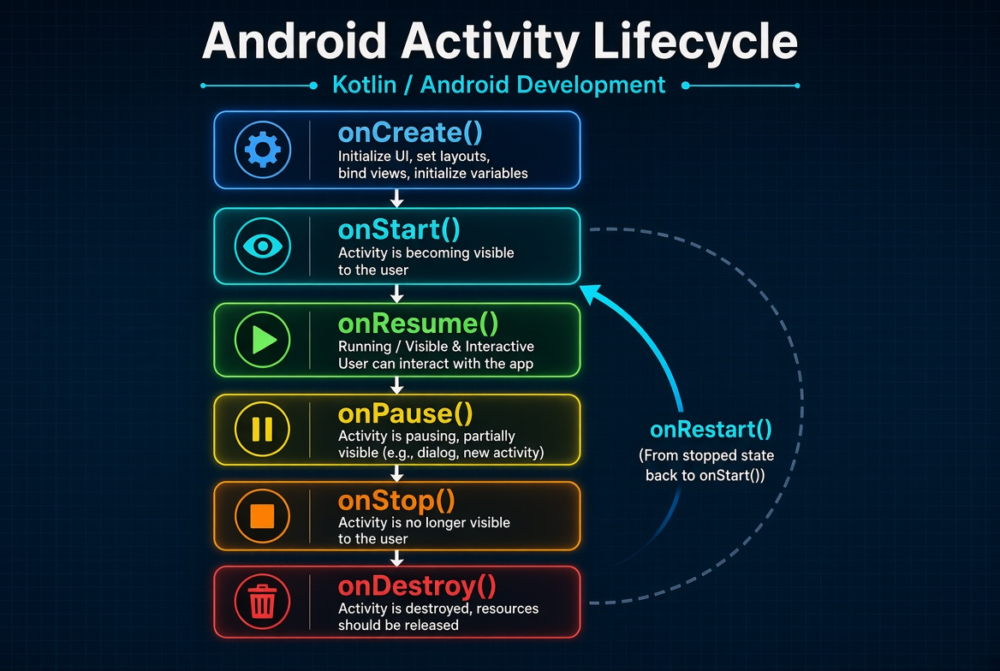

<!-- _class: cover_e -->
<!-- _paginate: "" -->
<!-- _footer:  -->
<!-- _header:  -->

# 第四章 应用组件与 Activity 生命周期

###### “理解生命周期，才理解 Android。”

张丽，井明
数据科学与计算机学院
jingming@sdu.edu.cn
2026年秋

---

<!-- _header: 目录<br>CONTENTS<br>-->
<!-- _class: toc_b -->
<!-- _footer: "" -->
<!-- _paginate: "" -->

- [四大组件与应用清单](#0)
- [Activity 生命周期](#0)
- [状态保存与配置变更](#0)
- [Intent 与页面跳转](#0)
- [资源管理与适配](#0)
- [Service、Broadcast 与 Provider](#0)

---

## 第一节 四大组件与应用清单

- 应用的组成单位
- AndroidManifest 的作用
- 任务栈与启动模式

---

### Android 四大组件

| 组件 | 作用 | 典型场景 |
| --- | --- | --- |
| **Activity** | 一个可交互的界面 | 登录页、列表页、详情页 |
| **Service** | 无界面的后台执行单元 | 音乐播放、数据同步 |
| **BroadcastReceiver** | 接收系统/应用广播 | 网络变化、开机启动 |
| **ContentProvider** | 跨应用共享结构化数据 | 通讯录、相册 |

> 共同点：都需要在 `AndroidManifest.xml` 中注册（动态广播除外），都由系统创建和管理，**不能用 `new` 直接使用**。

---

### AndroidManifest.xml

```xml
<manifest xmlns:android="http://schemas.android.com/apk/res/android">
    <uses-permission android:name="android.permission.INTERNET" />

    <application
        android:name=".MyApplication"
        android:icon="@mipmap/ic_launcher"
        android:label="@string/app_name"
        android:theme="@style/Theme.MyApp">

        <activity android:name=".MainActivity" android:exported="true">
            <intent-filter>
                <action android:name="android.intent.action.MAIN" />
                <category android:name="android.intent.category.LAUNCHER" />
            </intent-filter>
        </activity>
        <activity android:name=".DetailActivity" android:exported="false" />
    </application>
</manifest>
```

---

### Application 类

```kotlin
class MyApplication : Application() {
    override fun onCreate() {
        super.onCreate()
        // 全局初始化：日志、崩溃上报、数据库、依赖注入
        instance = this
    }

    companion object {
        lateinit var instance: MyApplication
            private set
    }
}
```

- 整个进程只有一个实例，先于任何组件创建
- **不要**在这里做耗时操作，会拖慢冷启动


---

| launchMode | 行为 |
| --- | --- |
| `standard`（默认） | 每次都创建新实例 |
| `singleTop` | 已在栈顶则复用，回调 `onNewIntent` |
| `singleTask` | 全栈唯一，之上的 Activity 全部出栈 |
| `singleInstance` | 独占一个任务栈 |

---

1. singleTop 启动模式
假设有三个 Activity：A、B、C，它们的启动模式均为默认的 standard。
当前返回栈为：

```
栈底 → A → B → C ← 栈顶
```

此时，C 的启动模式改为 singleTop，并且在当前 C 中再次启动 C：

```
val intent = Intent(this, C::class.java)
startActivity(intent)
```

请问，执行后 Activity 返回栈的状态是什么？

A. ``` A → B → C → C```
B. ```A → B → C```
C. ``` A → C```
D. ```系统会销毁当前的 C，然后创建一个新的 C。```

---

答案：B

解析：

singleTop 的核心特点是：

如果目标 Activity 已经位于当前任务栈的栈顶，则不会创建新的 Activity 实例，而是复用当前实例。

执行 startActivity() 时：

1. 系统发现 C 已经位于栈顶。
2. 不会创建新的 C 实例。
3. 当前 C 实例会收到 onNewIntent() 回调。
4. 返回栈保持不变。

因此，最终返回栈仍然是：

```
栈底 → A → B → C ← 栈顶
```

---

## 知识点补充

如果 C 不在栈顶，例如返回栈是：

```
A → B → C → D
```

此时从 D 启动 C，由于 C 不在栈顶，singleTop 不会复用栈中原来的 C，而是会创建一个新的 C。

最终返回栈为：

```
A → B → C → D → C
```

---

题目二：singleTask 启动模式

假设有三个 Activity：A、B、C。

其中，C 的启动模式为 singleTask，当前任务栈为：```栈底 → A → B → C```

随后，用户在 C 中启动 B，并且 B 的启动模式为默认的 standard。

此时，B 再次启动 C：

```
val intent = Intent(this, C::class.java)
startActivity(intent)
```

假设没有额外的 Intent Flag，也没有特殊的 taskAffinity 配置。请问，执行后返回栈是什么状态？

A. ```A → B → C → C``` B. ```A → B → C``` C. ```A → B → B → C``` D. ```A → B → C → B → C```

---

正确答案：B

解析：

singleTask 的核心特点是：

> 当目标 Activity 所属的任务中已经存在该 Activity 实例时，系统会复用该实例，并移除位于它上方的 Activity。

本题执行过程如下。

第一步：初始状态. ```A → B → C```
第二步：C 启动 B. 由于 B 使用默认的 standard 模式，系统会创建一个新的 B 实例。此时返回栈为： ```A → B → C → B```
第三步：新的 B 启动 C. 当 B 执行：
```
startActivity(Intent(this, C::class.java))
```

---

系统发现当前任务中已经存在 C 实例。

由于 C 使用 singleTask，系统会：

1. 复用已有的 C 实例。
2. 移除位于 C 上方的 Activity，包括新的 B。
3. 将 Intent 传递给已有的 C，触发 onNewIntent()。

最终返回栈恢复为：```栈底 → A → B → C ← 栈顶```
因此，正确答案是 B。

---

记忆技巧：

* standard：通常每次启动都创建新实例。
* singleTop：只检查栈顶。
* singleTask：复用任务栈中已有的目标实例，并清除它上方的 Activity。


---

## 第二节 Activity 生命周期

- 生命周期回调
- 三个关键状态
- 常见场景的回调序列

---
<!-- _footer: "" -->
<!-- ### 生命周期回调图 -->



---

### 各回调的职责

| 回调 | 何时调用 | 应该做什么 |
| --- | --- | --- |
| `onCreate` | 创建时一次 | 初始化 UI、恢复状态 |
| `onStart` | 变为可见 | 注册广播、开始订阅 |
| `onResume` | 获得焦点、可交互 | 启动动画、打开相机 |
| `onPause` | 失去焦点 | 暂停动画、**快速**保存草稿 |
| `onStop` | 完全不可见 | 释放较重资源、取消订阅 |
| `onDestroy` | 销毁 | 释放全部资源、断开引用 |

> `onPause` 必须**极快**返回，否则会阻塞下一个 Activity 的显示。


---

### 常见场景的回调序列

1. 启动应用

```
onCreate() → onStart() → onResume()
```

2. Activity A 启动 Activity B

```
A.onPause()
    ↓
B.onCreate() → B.onStart() → B.onResume()
    ↓
A.onStop()
```

---


3. 从 Activity B 返回 Activity A

```
B.onPause()
    ↓
A.onRestart() → A.onStart() → A.onResume()
    ↓
B.onStop() → B.onDestroy()
```

4. 按下 Home 键

```
onPause() → onStop()
```

5. 重新回到应用

```
onRestart() → onStart() → onResume()
```

---

6. 弹出对话框式界面

```
onPause()
```

> 说明： 如果对话框式 Activity 不会完全遮挡当前 Activity，且当前 Activity 仍然可见，则通常只会触发 onPause()，不会触发 onStop()。

---

7. 屏幕旋转

```
onPause()
    ↓
onStop()
    ↓
onDestroy()
    ↓
onCreate()
    ↓
onStart()
    ↓
onResume()
```
> 说明： 默认情况下，屏幕旋转等配置变更可能导致 Activity 被销毁并重新创建。如果通过 android:configChanges 等方式自行处理配置变更，生命周期回调序列可能不同。

---

生命周期回调速记

| 回调方法 | 主要作用 |
|---|---|
| `onCreate()` | Activity 创建，初始化界面和基础数据 |
| `onStart()` | Activity 即将对用户可见 |
| `onResume()` | Activity 进入前台，可以与用户交互 |
| `onPause()` | Activity 失去焦点，通常需要暂停部分操作 |
| `onStop()` | Activity 不再对用户可见 |
| `onRestart()` | 已停止的 Activity 即将重新启动 |
| `onDestroy()` | Activity 即将销毁，执行必要的清理工作 |

---

核心记忆：

* 首次启动： onCreate → onStart → onResume
* 进入后台： onPause → onStop
* 返回前台： onRestart → onStart → onResume
* 销毁重建： onPause → onStop → onDestroy → onCreate → onStart → onResume

---

### 用日志观察生命周期

```kotlin
class MainActivity : ComponentActivity() {
    private val tag = "LifeCycle"

    override fun onCreate(savedInstanceState: Bundle?) {
        super.onCreate(savedInstanceState)
        Log.d(tag, "onCreate")
        setContent { MyApp() }
    }

    override fun onStart()   { super.onStart();   Log.d(tag, "onStart") }
    override fun onResume()  { super.onResume();  Log.d(tag, "onResume") }
    override fun onPause()   { super.onPause();   Log.d(tag, "onPause") }
    override fun onStop()    { super.onStop();    Log.d(tag, "onStop") }
    override fun onDestroy() { super.onDestroy(); Log.d(tag, "onDestroy") }
}
```

> 实验二将用 Logcat 逐一验证上面每一条序列。

---

### 进程优先级

| 优先级 | 状态 | 被杀风险 |
| --- | --- | --- |
| 前台进程 | 有 Resumed 的 Activity | 极低 |
| 可见进程 | 有 Paused 的 Activity | 低 |
| 服务进程 | 运行着 Service | 中 |
| 后台进程 | 只有 Stopped 的 Activity | 高 |
| 空进程 | 无任何组件 | 最高 |

> 结论：**不能假设进程会一直存活**，必须正确保存状态。

---

## 第三节 状态保存与配置变更

- 配置变更导致的重建
- onSaveInstanceState
- ViewModel 与 rememberSaveable
- 三种状态保存机制的比较

---

### 配置变更

以下变化会导致 Activity **默认被销毁重建**：

- 屏幕旋转、折叠屏展开
- 系统语言切换
- 深色 / 浅色模式切换
- 字体大小、显示尺寸变化
- 分屏、窗口大小变化

> 这不是 bug，而是让应用重新加载匹配当前配置的资源（如 `values-en/`、`layout-land/`）。

---

### onSaveInstanceState

```kotlin
override fun onSaveInstanceState(outState: Bundle) {
    super.onSaveInstanceState(outState)
    outState.putString("draft", draftText)
    outState.putInt("count", count)
}

override fun onCreate(savedInstanceState: Bundle?) {
    super.onCreate(savedInstanceState)
    val draft = savedInstanceState?.getString("draft") ?: ""
    val count = savedInstanceState?.getInt("count") ?: 0
}
```

- 只适合**小量**数据（Bundle 有大小限制，超过约 1MB 会崩溃）
- 进程被系统回收后重启也能恢复

---

### 三种状态保存机制

| 机制 | 配置变更 | 进程被杀 | 用户主动退出 | 适合数据 |
| --- | --- | --- | --- | --- |
| 类的成员变量 | ✗ | ✗ | ✗ | 临时值 |
| `ViewModel` | ✓ | ✗ | ✗ | UI 状态、较大对象 |
| `SavedStateHandle` / `Bundle` | ✓ | ✓ | ✗ | 少量关键状态（ID、输入框） |
| 本地存储（DataStore/Room） | ✓ | ✓ | ✓ | 需要持久保留的数据 |

> 实践：**ViewModel 承载 UI 状态 + SavedStateHandle 保存关键标识 + 本地存储保存业务数据**。

---

### Compose 中的状态保存

```kotlin
@Composable
fun Counter() {
    var count by remember { mutableIntStateOf(0) }          // 重组保留，重建丢失
    var kept by rememberSaveable { mutableIntStateOf(0) }   // 重建后仍保留

    Column {
        Text("count = $count, kept = $kept")
        Button(onClick = { count++; kept++ }) { Text("加一") }
    }
}
```

> 旋转屏幕后 `count` 归零而 `kept` 保留 —— 这是理解两者差别最直观的实验。

---

## 第四节 Intent 与页面跳转

- 显式 Intent 与隐式 Intent
- 传递数据
- 接收返回结果
- 常用系统 Intent

---

### 显式 Intent

```kotlin
// 跳转到本应用的另一个 Activity
val intent = Intent(this, DetailActivity::class.java).apply {
    putExtra("id", 42)
    putExtra("title", "商品详情")
}
startActivity(intent)
```

```kotlin
// 在 DetailActivity 中接收
val id = intent.getIntExtra("id", -1)
val title = intent.getStringExtra("title") ?: ""
```

---

### 隐式 Intent

```kotlin
// 打开网页
startActivity(Intent(Intent.ACTION_VIEW, Uri.parse("https://kotlinlang.org")))

// 拨号
startActivity(Intent(Intent.ACTION_DIAL, Uri.parse("tel:10086")))

// 分享文本
val share = Intent(Intent.ACTION_SEND).apply {
    type = "text/plain"
    putExtra(Intent.EXTRA_TEXT, "分享内容")
}
startActivity(Intent.createChooser(share, "分享到"))
```

> 系统根据 `action` + `data` + `category` 匹配到能处理的应用。

---

### 接收返回结果

```kotlin
// 现代写法：Activity Result API
private val launcher = registerForActivityResult(
    ActivityResultContracts.StartActivityForResult()
) { result ->
    if (result.resultCode == RESULT_OK) {
        val value = result.data?.getStringExtra("result")
    }
}

// 发起
launcher.launch(Intent(this, EditActivity::class.java))

// 在 EditActivity 中返回
setResult(RESULT_OK, Intent().putExtra("result", "已保存"))
finish()
```

> `startActivityForResult` 已废弃，新项目一律用 Activity Result API。

---

### 传递对象

```kotlin
@Parcelize
data class User(val id: Int, val name: String) : Parcelable
// 需要在 build.gradle.kts 中启用 kotlin-parcelize 插件

intent.putExtra("user", User(1, "Tom"))

// 接收
val user = intent.getParcelableExtra("user", User::class.java)   // API 33+
```

- `Parcelable` 是 Android 专用序列化，比 `Serializable` 快得多
- 传递数据量应尽可能小；大对象请通过 ID + 本地存储传递

---

## 第五节 资源管理与适配

- 资源目录结构
- 资源引用
- 限定符与多语言
- 主题与深色模式

---

### 资源目录结构

```text
res/
├── drawable/          # 矢量图、shape、图片
├── mipmap-*/          # 应用图标（按密度）
├── layout/            # XML 布局（Compose 项目中较少用）
├── values/
│   ├── strings.xml    # 字符串
│   ├── colors.xml     # 颜色
│   ├── dimens.xml     # 尺寸
│   └── themes.xml     # 主题
├── values-en/         # 英文字符串
├── values-night/      # 深色模式资源
└── raw/               # 原始文件（音频、json）
```

---

### 资源引用

```xml
<!-- res/values/strings.xml -->
<resources>
    <string name="app_name">我的应用</string>
    <string name="welcome">欢迎，%1$s！你有 %2$d 条消息</string>
</resources>
```

```kotlin
// Kotlin 代码中
getString(R.string.app_name)
getString(R.string.welcome, "Tom", 3)

// Compose 中
Text(stringResource(R.string.app_name))
Text(stringResource(R.string.welcome, "Tom", 3))
Image(painterResource(R.drawable.ic_logo), contentDescription = null)
```

---

### 资源限定符

| 限定符 | 示例目录 | 匹配条件 |
| --- | --- | --- |
| 语言 | `values-en/`、`values-zh-rCN/` | 系统语言 |
| 屏幕方向 | `layout-land/` | 横屏 |
| 屏幕密度 | `drawable-xxhdpi/` | 屏幕 DPI |
| 夜间模式 | `values-night/` | 深色模式 |
| 最小宽度 | `values-sw600dp/` | 平板 |
| API 版本 | `values-v31/` | Android 12+ |

> 系统自动按当前配置**就近匹配**，找不到就回落到默认目录。

---

### 尺寸单位

| 单位 | 含义 | 用途 |
| --- | --- | --- |
| `dp` | 密度无关像素 | 布局尺寸、间距（**首选**） |
| `sp` | 缩放无关像素 | 字体大小（跟随系统字体设置） |
| `px` | 物理像素 | 极少直接使用 |

```kotlin
// Compose 中
Modifier.padding(16.dp).size(48.dp)
Text("标题", fontSize = 18.sp)
```

---

## 第六节 其他三大组件

- Service
- BroadcastReceiver
- ContentProvider

---

### Service

```kotlin
class MusicService : Service() {
    override fun onStartCommand(intent: Intent?, flags: Int, startId: Int): Int {
        // 在主线程被调用！耗时操作要另开线程
        return START_STICKY
    }
    override fun onBind(intent: Intent?): IBinder? = null
}
```

- **前台服务**：必须显示常驻通知（音乐、导航、录音）
- 后台执行限制越来越严，**定时/延迟任务请用 `WorkManager`**
- Service 默认运行在**主线程**，这是最常见的误解

---

### BroadcastReceiver

```kotlin
// 动态注册（推荐）
private val receiver = object : BroadcastReceiver() {
    override fun onReceive(context: Context, intent: Intent) {
        if (intent.action == Intent.ACTION_BATTERY_LOW) { /* ... */ }
    }
}

override fun onStart() {
    super.onStart()
    registerReceiver(receiver, IntentFilter(Intent.ACTION_BATTERY_LOW))
}
override fun onStop() {
    super.onStop()
    unregisterReceiver(receiver)      // 必须注销，否则泄漏
}
```

> 静态注册的隐式广播从 Android 8.0 起被大幅限制。

---

### ContentProvider

```kotlin
// 读取系统通讯录（需要 READ_CONTACTS 权限）
val cursor = contentResolver.query(
    ContactsContract.Contacts.CONTENT_URI,
    null, null, null, null
)
cursor?.use {
    while (it.moveToNext()) {
        val name = it.getString(
            it.getColumnIndexOrThrow(ContactsContract.Contacts.DISPLAY_NAME)
        )
    }
}
```

- 提供跨应用的统一数据访问入口，以 `content://` URI 标识
- 应用内部数据一般直接用 Room，不必自建 Provider

---

### 思考

1. 为什么屏幕旋转会导致 Activity 重建？能不能通过 `configChanges` 阻止？这样做有什么代价？
2. 用户在编辑框输入了一半内容，此时来电、系统回收了进程。要让内容不丢失，应该用哪种保存机制？
3. `singleTask` 和 `singleInstance` 在哪些实际场景中会用到？

---

<!-- _footer: "" -->
<!-- _class: trans -->

## 参考答案

---

1. 屏幕旋转为什么会导致 Activity 重建？

* 原因： 屏幕旋转会触发配置变更（Configuration Change），系统默认销毁旧 Activity 并创建新 Activity，以适配新的屏幕方向和布局。
* 能否阻止？ 可以，通过 AndroidManifest.xml 中的 android:configChanges 自行处理配置变更。

```
android:configChanges="orientation|screenSize"
```

* 代价： 需要自行适配布局、资源和界面状态，增加维护成本；处理不当可能导致界面显示异常。
* 建议： 简单场景优先使用默认重建机制，配合状态保存恢复。

---

2. 进程被系统回收，如何避免输入内容丢失？

* 临时状态保存： 使用 onSaveInstanceState() 保存编辑框内容，在 Activity 重建后恢复。
* ViewModel： 适合在配置变更（如屏幕旋转）时保留 UI 数据，但不能单独保证进程被杀后数据不丢失。
* 持久化存储： 使用 SharedPreferences、DataStore 或 Room，及时保存重要内容，即使进程被杀或应用重启也能恢复。

建议： 普通表单使用 onSaveInstanceState()；重要或较长的编辑内容应及时持久化。

---

3. singleTask 和 singleInstance 的实际应用场景

| 启动模式 | 特点 | 典型场景 |
|---|---|---|
| `singleTask` | 一个任务栈中最多存在一个该 Activity 实例；再次启动时复用实例，并清除其上方的 Activity | 应用主页面、通知点击后返回已有页面 |
| `singleInstance` | Activity 独占一个任务栈，该栈不放置其他 Activity | 特殊的独立交互页面、部分历史上的通话或系统级交互场景 |

> 注意： singleInstance 使用场景较少，可能带来任务栈管理和返回导航方面的复杂性。实际开发中应优先考虑默认启动模式或 singleTask，仅在确有独立任务栈需求时使用 singleInstance。

---

## 本章小结

- 四大组件由系统创建管理，通过 `AndroidManifest.xml` 声明
- Activity 生命周期的核心是三对回调：create/destroy、start/stop、resume/pause
- 配置变更会重建 Activity；用 ViewModel + `rememberSaveable` + 本地存储分层保存状态
- Intent 分显式与隐式；返回结果使用 Activity Result API
- 资源系统通过限定符自动适配语言、密度、方向、深色模式

---

## 课后作业

1. 完成 **实验四**：生命周期观察与页面跳转
2. 在纸上画出“A 启动 B 再返回 A”的完整回调时序图
3. 查阅文档，列出 `START_STICKY` / `START_NOT_STICKY` / `START_REDELIVER_INTENT` 的区别
4. 为自己的应用添加英文 `values-en/strings.xml`，切换系统语言验证

---

<!-- _class: lastpage -->
<!-- _footer: "" -->

###### 参考资料

---

- [应用基础知识 - Android 开发者](https://developer.android.google.cn/guide/components/fundamentals)
- [Activity 生命周期](https://developer.android.google.cn/guide/components/activities/activity-lifecycle)
- [保存界面状态](https://developer.android.google.cn/topic/libraries/architecture/saving-states)
