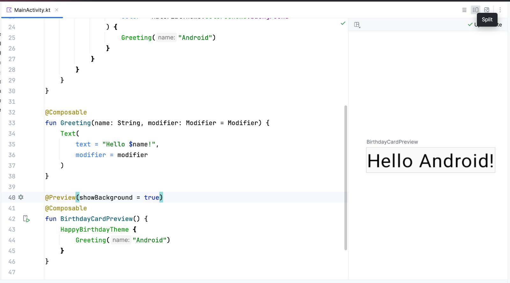

<!-- _class: cover_e -->
<!-- _paginate: "" -->
<!-- _footer:  -->
<!-- _header:  -->

# 第五章 Jetpack Compose UI 基础

###### “描述界面是什么，而不是怎样改变它。”

张丽，井明
数据科学与计算机学院
jingming@sdu.edu.cn
2026年秋

---

<!-- _header: 目录<br>CONTENTS<br>-->
<!-- _class: toc_b -->
<!-- _footer: "" -->
<!-- _paginate: "" -->

- [声明式 UI 与 Compose 概览](#0)
- [可组合函数与预览](#0)
- [基础组件](#0)
- [布局：Column / Row / Box](#0)
- [Modifier 修饰符](#0)
- [Material 3 与主题](#0)

---

## 第一节 声明式 UI 与 Compose 概览

- 命令式 vs 声明式
- Compose 的核心思想
- 与 XML View 体系的关系

---

### 命令式 UI 的问题

```kotlin
// 传统 View 体系：手动查找并修改控件状态
val textView = findViewById<TextView>(R.id.title)
val button = findViewById<Button>(R.id.btn)
button.setOnClickListener {
    count++
    textView.text = "计数：$count"
    if (count > 10) {
        textView.setTextColor(Color.RED)
        button.isEnabled = false
    }
}
```

问题：状态分散在各个控件里，**UI 与数据容易不一致**，分支越多越难维护。

---

### 声明式 UI

```kotlin
@Composable
fun Counter() {
    var count by remember { mutableIntStateOf(0) }

    Column {
        Text(
            text = "计数：$count",
            color = if (count > 10) Color.Red else Color.Unspecified
        )
        Button(onClick = { count++ }, enabled = count <= 10) {
            Text("加一")
        }
    }
}
```

> **UI = f(状态)**：状态变化 → 框架自动重新执行相关函数 → 界面更新。

---

### Compose 的核心概念

| 概念 | 含义 |
| --- | --- |
| **可组合函数** | 用 `@Composable` 标注，描述一段 UI |
| **重组（Recomposition）** | 状态改变时，Compose 重新执行受影响的函数 |
| **状态（State）** | `MutableState` 等可观察类型，是重组的触发源 |
| **单向数据流** | 状态向下传递，事件向上回调 |

---

### 重组的特点

- **智能跳过**：输入没变的可组合函数不会重新执行
- **可以任意顺序执行**，甚至并行执行
- **可能被取消**，也可能每帧执行多次

由此得出的**编程纪律**：

```kotlin
@Composable
fun Bad() {
    var i = 0            // ✗ 重组后被重置
    counterInDb++        // ✗ 副作用：每次重组都写数据库
    Text("$i")
}
```

> 可组合函数必须是**无副作用**的；副作用要放到 `LaunchedEffect` 等专用 API 中。

---

### Compose 与 View 的关系

- Compose 不是对 View 的封装，它直接绘制在 `ComposeView` 上
- 可互操作：
  - Compose 中嵌入 View：`AndroidView { ... }`
  - View 布局中嵌入 Compose：`ComposeView`
- 新项目建议 **Compose only**，老项目可逐屏迁移

---

## 第二节 可组合函数与预览

- @Composable 的规则
- 函数命名约定
- @Preview 预览

---

### 可组合函数的规则

```kotlin
@Composable
fun Greeting(name: String, modifier: Modifier = Modifier) {
    Text(text = "Hello, $name!", modifier = modifier)
}
```

规则与约定：

1. 只能在**另一个可组合函数**中调用
2. 命名用**大驼峰**、名词（`Greeting`、`UserCard`），不是动词
3. 返回 `Unit`，通过发射 UI 而非返回值工作
4. 建议接收 `modifier: Modifier = Modifier` 作为**第一个可选参数**
5. 尽量做成**无状态**的（状态由调用者传入）

---

### @Preview 预览

```kotlin
@Preview(showBackground = true)
@Composable
fun GreetingPreview() {
    MyAppTheme {
        Greeting("Android")
    }
}

@Preview(name = "深色", uiMode = Configuration.UI_MODE_NIGHT_YES)
@Preview(name = "大字体", fontScale = 1.5f)
@Preview(name = "平板", widthDp = 800, heightDp = 600)
@Composable
fun MultiPreview() { MyAppTheme { Greeting("Android") } }
```
>在 Android Kotlin 的 Jetpack Compose 中，@Preview 是一个预览注解（Annotation），用于在 Android Studio 中直接预览 Compose UI 界面，而不需要将程序安装到模拟器或真机上运行。 预览不需要运行模拟器，是 Compose 开发效率的关键。

---

<!-- _footer: "" -->



---

### @Preview 与 @Composable 的区别

注解| 作用
|---|---|
@Composable| 声明一个可以构建 Compose UI 的函数
@Preview| 告诉 Android Studio 可以预览这个 UI 函数

注意：
- @Composable 是构建界面的核心注解。
- @Preview 主要用于开发阶段的设计和调试。
- @Preview 不会决定 App 运行时的界面显示方式。
- Preview 函数通常不需要参数，带参数的 UI 函数可以通过 Preview 包装函数传入示例数据。

>一句话总结：
>@Composable 负责定义界面，@Preview 负责在 Android Studio 中预览界面。二者配合可以实现 Compose UI 的快速开发和可视化调试。

---

### 应用入口

```kotlin
class MainActivity : ComponentActivity() {
    override fun onCreate(savedInstanceState: Bundle?) {
        super.onCreate(savedInstanceState)
        enableEdgeToEdge()
        setContent {
            MyAppTheme {
                Surface(
                    modifier = Modifier.fillMaxSize(),
                    color = MaterialTheme.colorScheme.background
                ) {
                    MyApp()
                }
            }
        }
    }
}
```

---

## 第三节 基础组件

- Text / Button / TextField
- Image / Icon
- 交互组件

---

### Text

<!-- _footer: "" -->

```kotlin
Text(
    text = "Hello Compose",
    color = MaterialTheme.colorScheme.primary,
    fontSize = 20.sp,
    fontWeight = FontWeight.Bold,
    fontStyle = FontStyle.Italic,
    textAlign = TextAlign.Center,
    maxLines = 2,
    overflow = TextOverflow.Ellipsis,
    style = MaterialTheme.typography.titleMedium
)
```

```kotlin
// 富文本
Text(buildAnnotatedString {
    append("普通文字 ")
    withStyle(SpanStyle(color = Color.Red, fontWeight = FontWeight.Bold)) {
        append("高亮文字")
    }
})
```

---

### Button 与点击

```kotlin
Button(onClick = { /* 处理点击 */ }) {
    Icon(Icons.Default.Add, contentDescription = null)
    Spacer(Modifier.width(8.dp))
    Text("添加")
}

OutlinedButton(onClick = {}) { Text("次要操作") }
TextButton(onClick = {}) { Text("文字按钮") }
FilledTonalButton(onClick = {}) { Text("中等强调") }

IconButton(onClick = {}) {
    Icon(Icons.Default.Favorite, contentDescription = "收藏")
}

FloatingActionButton(onClick = {}) { Icon(Icons.Default.Add, null) }
```

---

### TextField


<!-- _footer: "" -->

```kotlin
var text by remember { mutableStateOf("") }

OutlinedTextField(
    value = text,
    onValueChange = { text = it },
    label = { Text("用户名") },
    placeholder = { Text("请输入") },
    leadingIcon = { Icon(Icons.Default.Person, null) },
    singleLine = true,
    isError = text.length > 20,
    supportingText = { if (text.length > 20) Text("不超过 20 个字符") },
    keyboardOptions = KeyboardOptions(
        keyboardType = KeyboardType.Text,
        imeAction = ImeAction.Done
    ),
    modifier = Modifier.fillMaxWidth()
)
```

> Compose 的输入框是**受控组件**：值来自状态，改变通过回调。

---

### 图片与图标

```kotlin
Image(
    painter = painterResource(R.drawable.avatar),
    contentDescription = "头像",
    contentScale = ContentScale.Crop,
    modifier = Modifier.size(80.dp).clip(CircleShape)
)

Icon(
    imageVector = Icons.Default.Settings,
    contentDescription = "设置",
    tint = MaterialTheme.colorScheme.primary
)
```

- `contentDescription` 用于无障碍朗读，纯装饰图传 `null`
- 网络图片使用 Coil：`AsyncImage(model = url, contentDescription = null)`

---

### 选择类组件

```kotlin
var checked by remember { mutableStateOf(false) }
Checkbox(checked = checked, onCheckedChange = { checked = it })

var on by remember { mutableStateOf(true) }
Switch(checked = on, onCheckedChange = { on = it })

var selected by remember { mutableStateOf("A") }
Row {
    listOf("A", "B").forEach { option ->
        RadioButton(selected = selected == option, onClick = { selected = option })
        Text(option)
    }
}

var progress by remember { mutableFloatStateOf(0.5f) }
Slider(value = progress, onValueChange = { progress = it })
```

---

## 第四节 布局

- Column / Row / Box
- 对齐与排列
- 权重与间距
- 其他常用容器

---

### Column：垂直排列

```kotlin
Column(
    modifier = Modifier.fillMaxWidth().padding(16.dp),
    verticalArrangement = Arrangement.spacedBy(8.dp),   // 子项间距
    horizontalAlignment = Alignment.CenterHorizontally  // 水平对齐
) {
    Text("第一行")
    Text("第二行")
    Button(onClick = {}) { Text("按钮") }
}
```

`verticalArrangement` 可选值：`Top` `Center` `Bottom` `SpaceBetween` `SpaceAround` `SpaceEvenly` `spacedBy(n.dp)`

---

### Row：水平排列

```kotlin
Row(
    modifier = Modifier.fillMaxWidth(),
    horizontalArrangement = Arrangement.SpaceBetween,
    verticalAlignment = Alignment.CenterVertically
) {
    Text("左侧")
    Text("右侧")
}
```

```kotlin
// weight：按比例分配剩余空间
Row {
    Box(Modifier.weight(1f).height(40.dp).background(Color.Red))
    Box(Modifier.weight(2f).height(40.dp).background(Color.Blue))
}
```

---

### Box：层叠

```kotlin
Box(
    modifier = Modifier.size(200.dp),
    contentAlignment = Alignment.Center
) {
    Image(painterResource(R.drawable.bg), null, Modifier.fillMaxSize())
    Text("居中文字", color = Color.White)
    Text(
        "右下角",
        modifier = Modifier.align(Alignment.BottomEnd).padding(8.dp)
    )
}
```

> Box 内的子项按声明顺序**从下往上**层叠，类似 FrameLayout。

---

### 其他常用容器

```kotlin
Spacer(Modifier.height(16.dp))              // 空白占位

HorizontalDivider()                          // 分隔线

Card(modifier = Modifier.fillMaxWidth()) {   // 卡片
    Column(Modifier.padding(16.dp)) { Text("卡片内容") }
}

Surface(color = MaterialTheme.colorScheme.surfaceVariant,
        shape = RoundedCornerShape(12.dp)) { Text("表面") }

Scaffold(
    topBar = { TopAppBar(title = { Text("标题") }) },
    floatingActionButton = { FloatingActionButton({}) { Icon(Icons.Default.Add, null) } }
) { padding ->
    Column(Modifier.padding(padding)) { /* 内容 */ }
}
```

> `Scaffold` 的 `padding` **必须**用到内容上，否则内容会被顶栏/底栏遮挡。

---

### 滚动

```kotlin
// 少量固定内容：verticalScroll
Column(
    modifier = Modifier.verticalScroll(rememberScrollState()).padding(16.dp)
) {
    repeat(20) { Text("第 $it 行") }
}
```

> 数据量大或不定长时**必须**用 `LazyColumn`（第六章），否则一次性构建全部子项会卡顿。

---

### 约束与自适应

```kotlin
BoxWithConstraints {
    if (maxWidth < 600.dp) {
        Column { Content() }        // 手机：竖排
    } else {
        Row { Content() }           // 平板：横排
    }
}
```

- 用 `WindowSizeClass` 做更规范的断点判断（Compact / Medium / Expanded）
- 尺寸单位一律用 `dp`，字号用 `sp`

---

## 第五节 Modifier 修饰符

- Modifier 的作用与链式顺序
- 常用修饰符
- 顺序带来的差异

---

### Modifier 是什么

```kotlin
Text(
    "Hello",
    modifier = Modifier
        .padding(16.dp)
        .background(Color.LightGray)
        .clickable { /* ... */ }
        .size(100.dp)
)
```

- 描述**尺寸、外观、行为、交互**的统一机制
- 链式调用，**顺序有意义**：从外到内依次应用
- 自定义组件应把 `modifier` 参数透传给最外层元素

---

<!-- _footer: "" -->

### 常用 Modifier

```kotlin
// 尺寸
.size(48.dp) .width(100.dp) .height(40.dp)
.fillMaxWidth() .fillMaxHeight() .fillMaxSize()
.fillMaxWidth(0.5f)             // 占一半宽度
.wrapContentSize()
.aspectRatio(16f / 9f)

// 间距与外观
.padding(16.dp) .padding(horizontal = 16.dp, vertical = 8.dp)
.background(Color.White, RoundedCornerShape(8.dp))
.border(1.dp, Color.Gray, RoundedCornerShape(8.dp))
.clip(CircleShape) .shadow(4.dp) .alpha(0.5f)

// 交互
.clickable { } .combinedClickable(onLongClick = { }) { }
.scrollable(...) .draggable(...)
```

---

### 顺序的影响

```kotlin
// A：先 padding 再 background —— 灰色区域不含内边距
Text("A", Modifier.padding(16.dp).background(Color.Gray))

// B：先 background 再 padding —— 灰色区域包含内边距
Text("B", Modifier.background(Color.Gray).padding(16.dp))
```

```kotlin
// 点击区域同理
.clickable {}.padding(16.dp)     // 点击区域不含 padding
.padding(16.dp).clickable {}     // 点击区域含 padding（通常这不是你想要的）
```

> 记忆法：**Modifier 从左到右，由外层向内层生效**。

---

<!-- _footer: "" -->

### Modifier 与传统 Android View 的区别

传统 Android XML 布局中，通过属性设置组件样式：

```xml
<TextView
    android:layout_width="match_parent"
    android:layout_height="wrap_content"
    android:padding="16dp"
    android:background="#FFFF00" />
```

Jetpack Compose 中：

```kotlin
Text(
    text = "Hello",
    modifier = Modifier
        .fillMaxWidth()
        .padding(16.dp)
        .background(Color.Yellow)
)
```

---

传统 Android View| Jetpack Compose
|---|---|
XML 属性| Modifier
layout_width| fillMaxWidth()
layout_height| height()
padding| padding()
background| background()
OnClickListener| clickable {}

---

<!-- _class: "tinytext" -->
<!-- _footer: "" -->

### Modifier 的设计思想

Modifier 有三个重要特点：
1. 不可变性（Immutable）：Modifier 不直接修改原对象，而是创建新的修饰器组合。
2. 链式组合（Chaining）：可以将多个修饰操作组合起来。
3. 职责分离（Separation of Concerns）：UI 组件负责显示内容，Modifier 负责控制组件的布局、外观和行为。

```kotlin
@Composable
fun MyButton() {
    Text(
        text = "提交",
        modifier = Modifier
            .padding(10.dp)
            .background(Color.Blue)
            .clickable {
                println("提交按钮被点击")
            }
            .padding(16.dp)
    )
}
```
---

### 总结：

Modifier 是 Jetpack Compose 中用于描述 UI 修饰行为的组合机制。它将传统 XML 中分散的布局、样式和交互属性统一到了 Kotlin 代码中。

---

## 第六节 Material 3 与主题

- Material Design 3
- 颜色、字体、形状
- 深色模式与动态取色

---

### 主题结构

```kotlin
@Composable
fun MyAppTheme(
    darkTheme: Boolean = isSystemInDarkTheme(),
    content: @Composable () -> Unit
) {
    val colorScheme = if (darkTheme) DarkColorScheme else LightColorScheme
    MaterialTheme(
        colorScheme = colorScheme,
        typography = Typography,
        shapes = Shapes,
        content = content
    )
}
```

---

在组件中读取主题值：

```kotlin
MaterialTheme.colorScheme.primary
MaterialTheme.typography.titleLarge
MaterialTheme.shapes.medium
```

---

### 颜色角色

| 角色 | 用途 |
| --- | --- |
| `primary` / `onPrimary` | 主要操作按钮、强调元素 |
| `secondary` / `tertiary` | 次要强调 |
| `background` / `onBackground` | 页面底色 |
| `surface` / `onSurface` | 卡片、对话框等表面 |
| `error` / `onError` | 错误提示 |

> **不要**硬编码 `Color(0xFF3F51B5)`；用语义化角色，深色模式才能自动适配。

---

### 排版

```kotlin
Text("大标题", style = MaterialTheme.typography.displaySmall)
Text("页面标题", style = MaterialTheme.typography.headlineMedium)
Text("卡片标题", style = MaterialTheme.typography.titleMedium)
Text("正文", style = MaterialTheme.typography.bodyMedium)
Text("辅助说明", style = MaterialTheme.typography.labelSmall)
```

- 三大类：`display` / `headline` / `title` / `body` / `label`
- 每类有 `Large` / `Medium` / `Small` 三档
- 统一使用主题排版，能保证全应用视觉一致

---

### 深色模式与动态取色

```kotlin
val colorScheme = when {
    Build.VERSION.SDK_INT >= Build.VERSION_CODES.S -> {     // Android 12+
        val ctx = LocalContext.current
        if (darkTheme) dynamicDarkColorScheme(ctx) else dynamicLightColorScheme(ctx)
    }
    darkTheme -> DarkColorScheme
    else -> LightColorScheme
}
```

- 动态取色（Material You）从用户壁纸生成配色
- 品牌色要求严格的应用可以关闭动态取色

---

### 思考题：

假设需要开发一个简单的商品购物车页面，页面包含商品名称、商品数量、商品总价和一个增加数量的按钮。
1. 如果采用传统命令式 UI 开发和 Jetpack Compose 声明式 UI 开发，两者在界面更新机制上有什么区别？
2. 当用户点击增加数量按钮时，Compose 如何通过 State 实现界面的自动更新？
3. 如果直接修改普通 Kotlin 变量，而不是使用 mutableStateOf()，界面还能自动更新吗？为什么？
4. 你认为声明式 UI 相比传统命令式 UI 有哪些优势和不足？

---

### 参考答案

1. 命令式 UI 与声明式 UI 的区别
- 命令式 UI：开发者主动调用方法修改控件，例如 setText()，明确告诉系统如何更新界面。
- 声明式 UI：开发者描述界面应该是什么样子，数据发生变化后，Compose 自动更新界面。
  
---

2. Compose 如何实现界面自动更新？

通过 mutableStateOf() 创建可观察状态。当商品数量发生变化时，Compose 检测到状态变化，触发重组（Recomposition），重新绘制相关 UI。

  
---

3. 普通 Kotlin 变量能否自动更新界面？

不能。普通变量不具备 Compose 状态观察能力，变量改变不会自动触发界面重组。需要使用 mutableStateOf() 等状态管理机制。

  
---

4. 声明式 UI 的优势与不足
- 优势：代码简洁、逻辑清晰、状态与界面关联紧密，减少手动更新 UI 的工作。
- 不足：需要理解状态管理和重组机制，不合理的状态设计可能导致不必要的重组和性能问题。

---

### 课堂练习

1. 用 `Column` + `Row` + `Card` 实现一个“个人名片”：圆形头像、姓名、学号、专业、一个“联系我”按钮
2. 把上题中的 `Card` 抽成无状态可组合函数 `ProfileCard(name, id, major, modifier)`，并写三个 `@Preview`（浅色 / 深色 / 大字体）
3. 对比 `.padding(8.dp).background(Color.Red)` 与 `.background(Color.Red).padding(8.dp)` 的渲染差异并解释
4. 用 `Scaffold` + `TopAppBar` + `FloatingActionButton` 搭一个页面骨架

---

## 本章小结

- Compose 是声明式 UI：**UI = f(状态)**，状态变化触发重组
- 可组合函数必须无副作用、可重复执行、命名用名词
- 三大布局：`Column`（纵）、`Row`（横）、`Box`（叠）；`weight` 分配剩余空间
- `Modifier` 链式且**顺序敏感**，从外向内生效
- 使用 Material 3 语义化的颜色与排版，自动获得深色模式适配

---

<!-- _class: lastpage -->
<!-- _footer: "" -->

###### 参考资料

---

- [Jetpack Compose 官方教程](https://developer.android.google.cn/develop/ui/compose/documentation)
- [Compose 布局基础](https://developer.android.google.cn/develop/ui/compose/layouts/basics)
- [Material 3 for Compose](https://developer.android.google.cn/develop/ui/compose/designsystems/material3)
