<!-- _class: cover_e -->
<!-- _paginate: "" -->
<!-- _footer:  -->
<!-- _header:  -->

# 第六章 Compose 状态管理与列表

###### “状态往下流，事件往上走。”

张丽，井明
数据科学与计算机学院
jingming@sdu.edu.cn
2026年秋

---

<!-- _header: 目录<br>CONTENTS<br>-->
<!-- _class: toc_b -->
<!-- _footer: "" -->
<!-- _paginate: "" -->

- [状态与重组](#0)
- [状态提升与单向数据流](#0)
- [LazyColumn 与列表](#0)
- [副作用 API](#0)
- [用户反馈组件](#0)
- [动画基础](#0)

---

## 第一节 状态与重组

- 什么是状态，什么是重组
- remember 与 mutableStateOf
- rememberSaveable 与状态的存活时间
- 重组作用域与跳过

---

### 声明式 UI 的核心公式

> **UI = f(State)**：界面是状态的函数。状态变了，Compose 重新调用函数得到新界面。

| | 命令式（View 体系） | 声明式（Compose） |
| --- | --- | --- |
| 更新方式 | 找到控件，调用 `textView.setText(...)` | 修改状态，界面**自动**跟着变 |
| 关注点 | "怎么改"：每一步操作 | "是什么"：某个状态下界面长什么样 |
| 常见 bug | 忘了同步某个控件，界面与数据不一致 | 状态是唯一来源，不会不一致 |

- 可组合函数**不返回控件**，而是"描述"界面；Compose 负责把描述变成像素
- 因此：**想让界面变化，唯一的办法就是改变状态**

---

### 状态的定义

> 状态 = **任何随时间变化、并会影响 UI 的值**

- 输入框的文本、复选框是否勾选
- 列表数据、当前选中的标签页
- 是否正在加载、是否出错

```kotlin
@Composable
fun Counter() {
    var count by remember { mutableIntStateOf(0) }
    Button(onClick = { count++ }) { Text("点击 $count 次") }
}
```

点击 → `count` 变化 → Compose 重新执行 `Counter()` 中读取了 `count` 的部分 → 按钮文字更新。这个"重新执行"的过程就叫**重组（Recomposition）**。

---

### 重组是怎么发生的

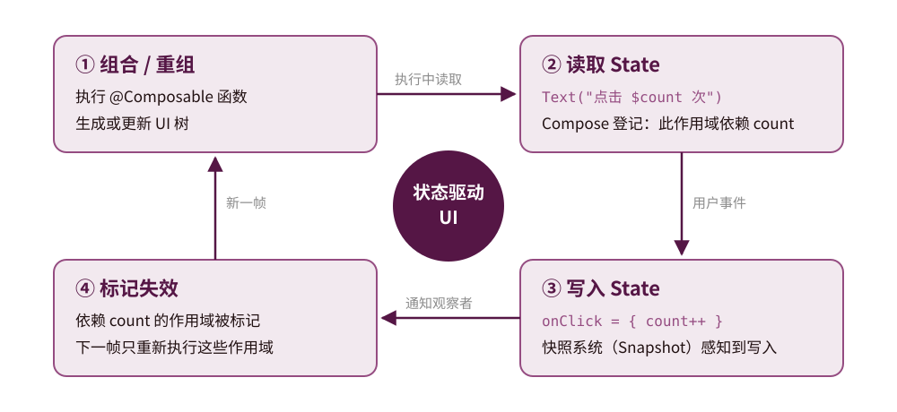

- `mutableStateOf` 创建的对象属于 Compose 的**快照系统（Snapshot）**，读写都会被追踪
- 普通变量的读写不会被追踪 → 改了也不会触发重组

---

### 重组的五个特性

1. **可以跳过**：参数没变的可组合函数会被跳过，不会重新执行
2. **可能非常频繁**：动画、滚动时可能每帧（约 16ms）都要重组
3. **执行顺序不确定**：不要假设兄弟组件按书写顺序执行
4. **可能被取消**：重组进行中状态又变了，本次重组会被丢弃、重新开始
5. **可能并行**：未来 Compose 可能在多个线程上执行重组

由此得出编写可组合函数的规则：

> 可组合函数应当**快速、幂等、无副作用**——相同输入总产生相同 UI，且不修改外部变量、不发请求、不写文件。需要副作用时使用第四节的 Effect API。

---

### remember 与 mutableStateOf 各自的职责

```kotlin
val state = remember { mutableStateOf(0) }
//           ↑ 跨重组保留值      ↑ 值变化时通知 Compose 重组
```

- `mutableStateOf`：创建**可观察**的状态容器，写它会触发重组
- `remember`：把对象存入组合（Composition），在重组之间**存活**，不会每次重新创建

三种等价写法：

```kotlin
val state = remember { mutableStateOf(0) }; state.value++      // 显式
val (v, setV) = remember { mutableStateOf(0) }; setV(v + 1)    // 解构
var count by remember { mutableStateOf(0) }; count++           // by 委托（推荐）
```

> `by` 需要 `import androidx.compose.runtime.getValue / setValue`

---

### 两种常见错误

```kotlin
// ✗ 错误 1：只有 mutableStateOf，没有 remember
@Composable
fun Bad1() {
    var count by mutableStateOf(0)          // 每次重组都重新创建 → 永远是 0
    Button(onClick = { count++ }) { Text("$count") }
}

// ✗ 错误 2：只有 remember，没有 mutableStateOf
@Composable
fun Bad2() {
    val holder = remember { Holder() }      // class Holder { var count = 0 }
    Button(onClick = { holder.count++ }) {  // 值保留了，但 Compose 不知道它变了
        Text("${holder.count}")             // 界面不刷新
    }
}
```

> `remember` 负责"保留"，`mutableStateOf` 负责"通知"，两者缺一不可。

---

### 基本类型的专用 State

```kotlin
var count by remember { mutableIntStateOf(0) }       // 避免装箱
var ratio by remember { mutableFloatStateOf(0f) }
var total by remember { mutableLongStateOf(0L) }
var flag  by remember { mutableStateOf(false) }
```

```kotlin
// 集合状态：两种做法
val items = remember { mutableStateListOf<String>() }   // 内容变化即触发重组
items.add("新项")

var list by remember { mutableStateOf(listOf<String>()) }  // 整体替换
list = list + "新项"
```

> 用普通 `mutableListOf` 存到 `remember` 里，**增删不会触发重组**——常见错误。原因与上页"错误 2"相同：`MutableList` 不是快照状态。

---

### remember 的 key

```kotlin
@Composable
fun UserDetail(userId: Int) {
    // userId 改变时丢弃旧值，重新计算；userId 不变则一直复用缓存
    val formatted = remember(userId) { heavyFormat(userId) }
    Text(formatted)
}
```

- `remember(key1, key2, …) { … }`：任意一个 key 变化，就重新执行 lambda
- 不带 key 的 `remember { }`：只在**首次进入组合**时执行一次
- 典型用途：缓存耗时计算；参数变化时**重置**内部状态
- 常见错误：`remember { heavyFormat(userId) }` 漏写 key → userId 变了仍显示旧值

---

### rememberSaveable

`remember` 的值存在组合里。旋转屏幕时 Activity 重建，组合也被销毁重建 → 值丢失。

```kotlin
var name by rememberSaveable { mutableStateOf("") }   // 存进 Bundle
```

- 直接支持能放进 `Bundle` 的类型：基本类型、`String`、`Parcelable` 等
- 自定义类型：加 `@Parcelize`，或提供 `Saver`；Bundle 有大小限制，只存**少量 UI 状态**

```kotlin
data class City(val name: String, val country: String)

val CitySaver = mapSaver(
    save = { mapOf("name" to it.name, "country" to it.country) },
    restore = { City(it["name"] as String, it["country"] as String) }
)
var city by rememberSaveable(stateSaver = CitySaver) { mutableStateOf(City("济南", "中国")) }
```

---

### 状态能活多久

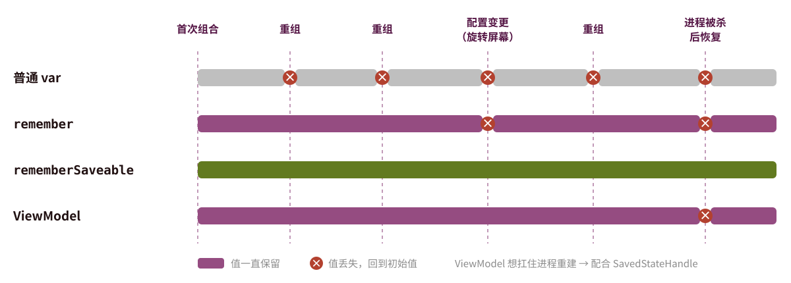

- 输入框文字、展开状态等**纯 UI 状态** → `rememberSaveable`
- 屏幕数据、业务状态 → ViewModel（需要扛住进程重建时配合 `SavedStateHandle`）

---

### 重组的作用域

```kotlin
@Composable
fun Screen() {
    var count by remember { mutableIntStateOf(0) }

    Column {
        Header()                      // 参数没变 → 被跳过
        Text("计数：$count")           // 参数变了 → 重新执行
        Button(onClick = { count++ }) { Text("加一") }   // 被跳过
    }
}
```

- Compose 以**读取状态的最小作用域**为单位重组
- 每个**非内联**的可组合函数（及其 lambda）都是一个可重组的作用域
- `Column`、`Row`、`Box` 是 `inline` 函数，没有自己的作用域

---

### 重组作用域图解

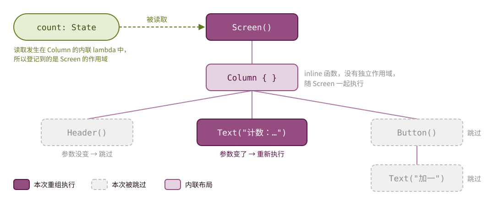

`count` 在 `Column` 的内联 lambda 中被读取，登记到 `Screen` 的作用域。`Screen` 重新执行，但子组件逐个比较参数：没变的直接跳过。

---

### 缩小重组范围的技巧

**1. 把读取状态的位置下沉到叶子组件**

```kotlin
@Composable
fun CountText(count: () -> Int) {      // 传 lambda 而不是值
    Text("计数：${count()}")            // 读取发生在这里 → 只有 CountText 重组
}
// 调用方：CountText { count }
```

**2. 把读取推迟到布局 / 绘制阶段**

```kotlin
val scroll = rememberScrollState()
// ✗ 每次滚动都会重组
Box(Modifier.offset(y = scroll.value.dp))
// ✓ 在布局阶段读取，跳过组合阶段
Box(Modifier.offset { IntOffset(0, scroll.value) })
```

---

### 稳定性：Compose 如何判断"参数没变"

- **稳定类型**：基本类型、`String`、函数类型、所有属性都是 `val` 且为稳定类型的 `data class`
- **不稳定类型**：含 `var` 属性的类、`List` / `Map` 等接口（可能是可变实现）

```kotlin
data class Todo(val id: Long, val title: String, val done: Boolean)   // 稳定

@Immutable                                 // 向编译器承诺：创建后不会再变
data class TodoUiState(val items: List<Todo>)
```

- Kotlin 2.0.20 起默认开启**强跳过模式（Strong Skipping）**：
  - 稳定参数用 `equals` 比较；不稳定参数用 `===`（是否同一个对象）比较
  - lambda 会被自动 `remember`
- 实践建议：UI 状态用**不可变的 data class**，修改时用 `copy()` 生成新对象

---

## 第二节 状态提升与单向数据流

- 有状态与无状态组件
- 状态提升及其规则
- 单向数据流
- ViewModel 承载状态

---

### 有状态 vs 无状态

```kotlin
// 有状态：自己持有状态，难以复用和测试
@Composable
fun StatefulCounter() {
    var count by remember { mutableIntStateOf(0) }
    Button(onClick = { count++ }) { Text("$count") }
}

// 无状态：状态由外部传入，事件向外回调
@Composable
fun StatelessCounter(count: Int, onIncrement: () -> Unit) {
    Button(onClick = onIncrement) { Text("$count") }
}
```

- Material 组件几乎都是无状态的：`TextField(value, onValueChange)`、`Checkbox(checked, onCheckedChange)`
- 无状态组件只是"把参数画出来"，就像一个纯函数

---

### 状态提升（State Hoisting）

```kotlin
@Composable
fun CounterScreen() {
    var count by rememberSaveable { mutableIntStateOf(0) }      // 状态在上层

    Column {
        StatelessCounter(count) { count++ }
        StatelessCounter(count) { count-- }     // 两处共享同一状态
        Text("当前值：$count")
    }
}
```

状态提升的模式：把 `value: T` 和 `onValueChange: (T) -> Unit` 两个参数提到调用方。

**好处**：单一数据源、易复用、易测试、易预览；状态可被拦截（如限制最大值）。

---

### 状态提升图解

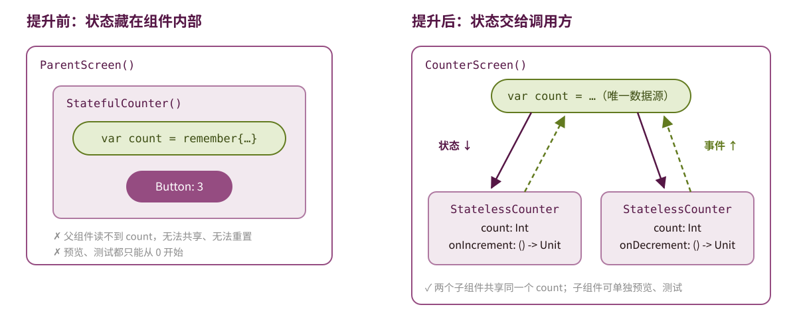

---

### 状态应该提升到哪里

三条规则：

1. 至少提升到所有**读取**该状态的组件的**最低公共父组件**
2. 至少提升到所有可能**修改**该状态的组件的最高层
3. 如果两个状态总是因同一事件一起变化，把它们**放在一起**

| 状态的性质 | 放在哪里 |
| --- | --- |
| 只影响局部外观（展开/收起、动画进度） | 组件内部 `remember` |
| 多个子组件共享的 UI 状态 | 公共父组件，或一个**状态容器类** |
| 需要业务逻辑、需要访问数据层 | **ViewModel** |

> 不是越高越好：提升过高会导致更大范围的重组，代码也更难读。

---

### 普通状态容器类

当一个组件的 UI 状态和逻辑变多时，把它们收进一个类，并提供 `rememberXxxState()`：

```kotlin
class SearchBarState(initial: String) {
    var query by mutableStateOf(initial)
        private set
    var expanded by mutableStateOf(false)

    fun onQueryChange(q: String) { query = q.take(50); expanded = q.isNotEmpty() }
    fun clear() { query = ""; expanded = false }
}

@Composable
fun rememberSearchBarState(initial: String = "") =
    remember { SearchBarState(initial) }
```

> Compose 自带的 `rememberLazyListState()`、`rememberScrollState()`、`SnackbarHostState` 都是这种模式。

---

### 单向数据流（UDF）

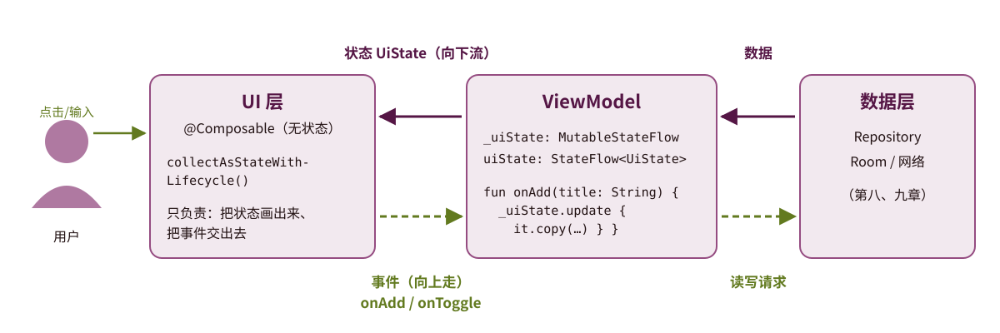

- 状态**只**从上往下流动；事件**只**从下往上回调
- UI 永远不直接修改数据，只"请求"修改 → 数据在哪改、为什么改都可追踪

---

### 用 ViewModel 承载状态

```kotlin
class CounterViewModel : ViewModel() {
    private val _count = MutableStateFlow(0)          // 私有、可写
    val count: StateFlow<Int> = _count.asStateFlow()  // 公开、只读

    fun increment() { _count.value++ }
    fun reset() { _count.value = 0 }
}
```

```kotlin
@Composable
fun CounterScreen(viewModel: CounterViewModel = viewModel()) {
    val count by viewModel.count.collectAsStateWithLifecycle()

    StatelessCounter(count, viewModel::increment)
}
```

- ViewModel 在配置变更中**存活**，是承载屏幕级状态的标准位置（第七章展开）

---

### StateFlow 与 Compose State 的衔接

| | `State<T>`（Compose） | `StateFlow<T>`（协程） |
| --- | --- | --- |
| 所属 | Compose 运行时 | Kotlin 协程库 |
| 适合位置 | 可组合函数、状态容器类 | ViewModel、数据层 |
| 观察方式 | 读取即自动订阅 | 需要 collect |

```kotlin
// 依赖：androidx.lifecycle:lifecycle-runtime-compose
val uiState by viewModel.uiState.collectAsStateWithLifecycle()
```

- `collectAsStateWithLifecycle()`：把 Flow 转成 State，**App 进入后台时自动停止收集**，回到前台再恢复
- `collectAsState()`：不感知生命周期，后台仍在收集，浪费资源 → Android 上优先用前者

---

### UI State 建模

```kotlin
data class TodoUiState(
    val items: List<Todo> = emptyList(),
    val isLoading: Boolean = false,
    val error: String? = null,
    val filter: Filter = Filter.ALL
)

class TodoViewModel : ViewModel() {
    private val _uiState = MutableStateFlow(TodoUiState())
    val uiState: StateFlow<TodoUiState> = _uiState.asStateFlow()

    fun toggleFilter(f: Filter) {
        _uiState.update { it.copy(filter = f) }     // 用 copy 生成新状态
    }
}
```

> 一个屏幕**一个** UI State 数据类，比散落的十个 `mutableStateOf` 更好维护。

---

### 事件建模

事件多了以后，可用一个密封接口统一描述"用户能做什么"：

```kotlin
sealed interface TodoEvent {
    data class Add(val title: String) : TodoEvent
    data class Toggle(val id: Long) : TodoEvent
    data class Delete(val id: Long) : TodoEvent
    data class ChangeFilter(val filter: Filter) : TodoEvent
}

class TodoViewModel : ViewModel() {
    fun onEvent(e: TodoEvent) = when (e) {
        is TodoEvent.Add -> add(e.title)
        is TodoEvent.Toggle -> toggle(e.id)
        is TodoEvent.Delete -> delete(e.id)
        is TodoEvent.ChangeFilter -> _uiState.update { it.copy(filter = e.filter) }
    }
}
// UI 只需一个回调：TodoScreen(uiState, onEvent = viewModel::onEvent)
```

---

## 第三节 LazyColumn 与列表

- LazyColumn 原理与 DSL
- key 与 contentType
- 列表状态与滚动控制
- 网格、粘性标题、四种列表状态

---

### LazyColumn 基础

```kotlin
@Composable
fun TodoList(items: List<Todo>) {
    LazyColumn(
        modifier = Modifier.fillMaxSize(),
        contentPadding = PaddingValues(16.dp),
        verticalArrangement = Arrangement.spacedBy(8.dp)
    ) {
        items(items, key = { it.id }) { todo ->
            TodoItem(todo)
        }
    }
}
```

- **只组合和布局可见项**，相当于 RecyclerView 的能力，但无需 Adapter/ViewHolder
- `contentPadding` 给整体加内边距，`Arrangement.spacedBy` 给项间加间距
- 横向列表用 `LazyRow`，用法完全相同

---

### 为什么要 "Lazy"

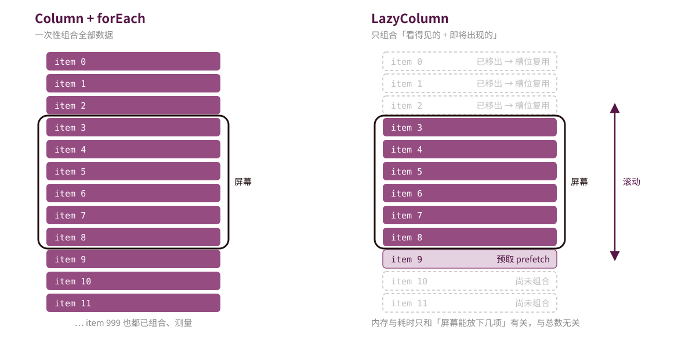

`Column` + `verticalScroll` 只适合**少量、固定**的内容（如设置页）；数据条数不定或较多时一律用 `LazyColumn`。

---

### DSL 的完整写法

```kotlin
LazyColumn {
    item {                                   // 单个项：头部
        Text("我的待办", style = MaterialTheme.typography.headlineSmall)
    }

    items(todos, key = { it.id }) { todo ->   // 数据列表
        TodoRow(todo)
    }

    item {                                    // 尾部
        if (isLoading) CircularProgressIndicator()
    }
}
```

> `LazyColumn { }` 里面是**DSL 作用域**而不是可组合作用域：不能直接写 `Text()`，必须放进 `item { }` / `items { }`。

---

### key 为什么重要

```kotlin
items(todos, key = { it.id }) { ... }
```

不指定 `key` 时，Compose 用**位置**作为标识：

- 在列表头部插入一条 → 其后所有项都被认为"变了" → 全部重组
- 项内部的 `remember` 状态会**错位**（如展开状态跑到别的项上）
- 动画表现错误；滚动位置也可能跳动

key 的要求：

- **唯一**：同一列表内不能重复，否则直接崩溃
- **稳定**：同一条数据的 key 不能变（不要用下标、不要用 `Random`）
- 可放进 `Bundle`：基本类型、`String`、`Parcelable`

---

### key 图解

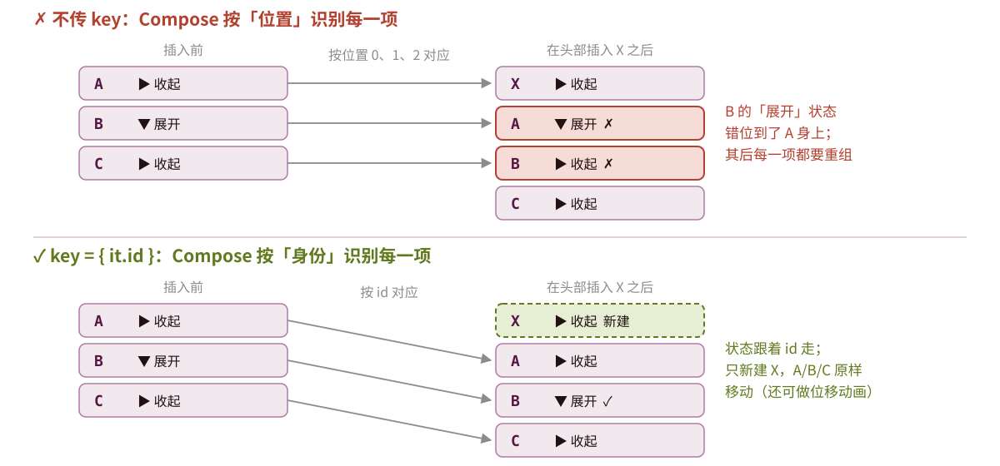

---

### contentType：按类型复用

```kotlin
LazyColumn {
    items(
        feed,
        key = { it.id },
        contentType = { it.type }      // "text"、"image"、"ad" …
    ) { post ->
        when (post.type) {
            "image" -> ImagePost(post)
            "ad"    -> AdCard(post)
            else    -> TextPost(post)
        }
    }
}
```

- 滑出屏幕的项会被**复用**给新滑入的项；声明 `contentType` 后只在**同类型**之间复用

---

### 列表项组件

```kotlin
@Composable
fun TodoRow(todo: Todo, onToggle: (Boolean) -> Unit, onDelete: () -> Unit) {
    ListItem(
        headlineContent = { Text(todo.title) },
        supportingContent = { Text(todo.createdAt) },
        leadingContent = {
            Checkbox(checked = todo.done, onCheckedChange = onToggle)
        },
        trailingContent = {
            IconButton(onClick = onDelete) {
                Icon(Icons.Default.Delete, contentDescription = "删除")
            }
        },
        modifier = Modifier.clickable { onToggle(!todo.done) }
    )
}
```

> 列表项也遵循状态提升：`todo` 由外部传入，勾选/删除通过回调交给 ViewModel。

---

### 列表状态与滚动控制

```kotlin
val listState = rememberLazyListState()
val scope = rememberCoroutineScope()

LazyColumn(state = listState) { items(data) { Item(it) } }

// 回到顶部
FloatingActionButton(onClick = {
    scope.launch { listState.animateScrollToItem(0) }
}) { Icon(Icons.Default.KeyboardArrowUp, null) }

// 派生状态：只有布尔值变化时才重组，避免每次滚动都重组
val showFab by remember {
    derivedStateOf { listState.firstVisibleItemIndex > 3 }
}
```

- `animateScrollToItem` 是挂起函数 → 在点击回调中用 `scope.launch` 调用

---

### derivedStateOf 与 remember(key) 的区别

`firstVisibleItemIndex` 滚动时不断变化：0,1,2,3,4,5…，但 `> 3` 的结果只在 3→4 那一刻变化一次。

```kotlin
// ✗ 每次索引变化都重组读取 showFab 的地方
val showFab = listState.firstVisibleItemIndex > 3

// ✓ 只有 true/false 翻转时才通知重组
val showFab by remember { derivedStateOf { listState.firstVisibleItemIndex > 3 } }
```

| | 适用场景 |
| --- | --- |
| `remember(key) { 计算 }` | 输入是**普通参数**，变化频率与输出相当 |
| `remember { derivedStateOf { } }` | 输入是 **State**，变化**远比**输出频繁 |

> 判断依据：输入变化 100 次、输出才变 1 次 → `derivedStateOf`。

---

### 网格与粘性标题

```kotlin
LazyVerticalGrid(
    columns = GridCells.Fixed(2),                  // 或 GridCells.Adaptive(120.dp)
    contentPadding = PaddingValues(8.dp),
    horizontalArrangement = Arrangement.spacedBy(8.dp),
    verticalArrangement = Arrangement.spacedBy(8.dp)
) {
    items(photos, key = { it.id }) { PhotoCard(it) }
}
```

```kotlin
LazyColumn {
    grouped.forEach { (letter, contacts) ->
        stickyHeader { SectionHeader(letter) }
        items(contacts, key = { it.id }) { ContactRow(it) }
    }
}
```

`Adaptive(minSize)` 按屏幕宽度自动决定列数；瀑布流用 `LazyVerticalStaggeredGrid`

---

### 空状态与加载状态

```kotlin
when {
    uiState.isLoading -> Box(Modifier.fillMaxSize(), Alignment.Center) {
        CircularProgressIndicator()
    }
    uiState.error != null -> ErrorView(uiState.error) { viewModel.retry() }
    uiState.items.isEmpty() -> EmptyView("还没有任何待办，点击 + 添加")
    else -> TodoList(uiState.items)
}
```

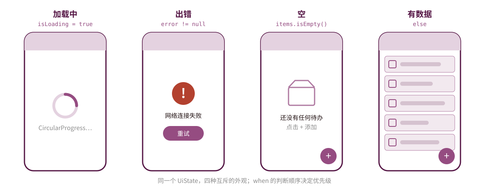

---

### 列表常见陷阱

```kotlin
// ✗ 同方向嵌套：LazyColumn 放进可垂直滚动的 Column → 运行时崩溃
Column(Modifier.verticalScroll(rememberScrollState())) {
    LazyColumn { … }
}
// ✓ 把头部、尾部都写成 LazyColumn 的 item { }
```

- **不要在 item 中做耗时计算**：排序、过滤放到 ViewModel，item 只负责显示
- **避免 0 高度的项**：图片未加载时给占位尺寸，否则首屏会一次组合大量项
- **不要用下标当 key**：`key = { index }` 与不写 key 效果相同
- **项内状态要么提升，要么用 key 绑定**：否则滚出屏幕再回来时会被重置

---

## 第四节 副作用 API

- 什么是副作用
- LaunchedEffect / rememberCoroutineScope
- DisposableEffect
- 其他副作用 API 与选择方法

---

### 为什么需要副作用 API

```kotlin
@Composable
fun BadScreen(id: Int) {
    val data = fetchFromNetwork(id)     // ✗ 每次重组都发起网络请求！
    Text(data)
}
```

**副作用**：在可组合函数的作用域之外，对 App 状态产生影响的操作——网络请求、写数据库、注册监听、打日志、弹 Snackbar……

回顾重组的特性：可组合函数会被**多次、任意时机**执行，还可能被取消。因此所有副作用必须放进专用 API，由 Compose 控制：

- **何时执行**：进入组合时？key 变化时？每次重组后？
- **何时停止 / 清理**：离开组合时自动取消或调用清理代码

---

### LaunchedEffect

```kotlin
@Composable
fun UserScreen(userId: Int, viewModel: UserViewModel) {
    LaunchedEffect(userId) {           // key 变化时取消旧协程并重启
        viewModel.load(userId)
    }

    LaunchedEffect(Unit) {             // 只在首次进入组合时执行一次
        viewModel.trackScreenView()
    }
}
```

- 在组合中启动协程，块内可以直接调用挂起函数（`delay`、网络请求……）
- 离开组合时**自动取消**
- key 相同则不重复执行；key 变化则重启
- key 选择原则：块里用到的、变化后需要重新执行的值，都应作为 key

---

### rememberCoroutineScope

```kotlin
@Composable
fun Screen(snackbarHostState: SnackbarHostState) {
    val scope = rememberCoroutineScope()

    Button(onClick = {
        scope.launch {                 // 在事件回调中启动协程
            snackbarHostState.showSnackbar("已保存")
        }
    }) { Text("保存") }
}
```

- `onClick` 不是可组合函数，不能在里面写 `LaunchedEffect`
- 作用域绑定到组合，离开组合时自动取消其中所有协程
- 对比：`LaunchedEffect` 由组合**自动**触发；它由**用户事件**手动触发

---

### DisposableEffect

```kotlin
@Composable
fun NetworkObserver(onChange: (Boolean) -> Unit) {
    val context = LocalContext.current
    DisposableEffect(context) {
        val receiver = object : BroadcastReceiver() { /* ... */ }
        context.registerReceiver(receiver, IntentFilter(/*...*/))

        onDispose {                    // 离开组合时清理
            context.unregisterReceiver(receiver)
        }
    }
}
```

- 块的最后**必须**是 `onDispose { }`；key 变化时先执行旧的 `onDispose`，再重新执行块
- 凡是"注册就必须注销"的资源（广播、监听器、传感器），都用它

---

### 三种 Effect 的生命周期对比

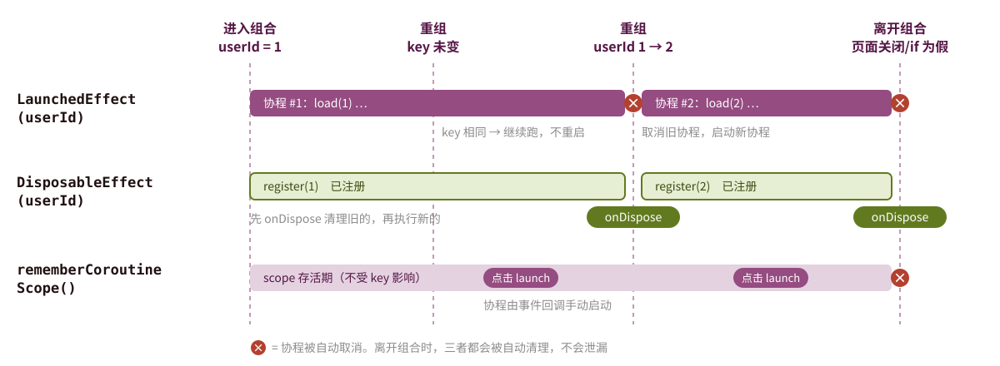

---

### rememberUpdatedState 与 produceState

```kotlin
// rememberUpdatedState：在长时间运行的 effect 中引用最新的回调
@Composable
fun Timer(onTimeout: () -> Unit) {
    val currentOnTimeout by rememberUpdatedState(onTimeout)
    LaunchedEffect(Unit) {         // 不希望 onTimeout 变化时重启计时
        delay(5000)
        currentOnTimeout()         // 使用最新值，而非捕获时的旧值
    }
}

// produceState：把非 Compose 数据源转成 State
val user by produceState<User?>(initialValue = null, userId) {
    value = repository.getUser(userId)
}
```

> lambda 会**捕获**创建时的值：`LaunchedEffect(Unit)` 不重启，就会一直用旧的 `onTimeout`。

---

### snapshotFlow 与 SideEffect

```kotlin
// snapshotFlow：把 Compose State 转成 Flow，便于使用 Flow 操作符
LaunchedEffect(listState) {
    snapshotFlow { listState.firstVisibleItemIndex }
        .map { it > 0 }
        .distinctUntilChanged()
        .filter { it }
        .collect { analytics.log("用户开始滚动列表") }
}
```

```kotlin
// SideEffect：每次重组成功后执行，把 Compose 状态同步给非 Compose 对象
@Composable
fun AnalyticsUser(user: User, analytics: Analytics) {
    SideEffect { analytics.setUserProperty("type", user.type) }
}
```

> 外部 → State：`produceState`、`collectAsStateWithLifecycle`；State → 外部：`snapshotFlow`、`SideEffect`

---

### 如何选择副作用 API

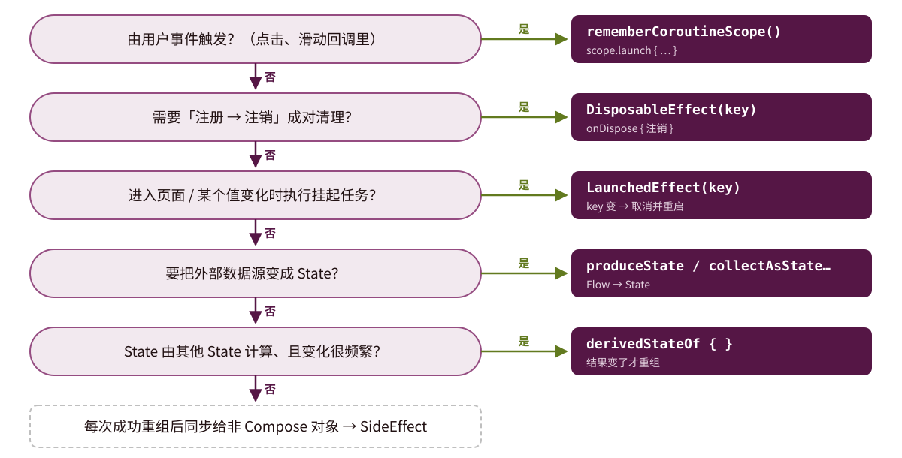

---

## 第五节 用户反馈组件

- Scaffold 与 Snackbar
- Dialog
- 下拉菜单与底部弹窗

---

### Scaffold 的槽位

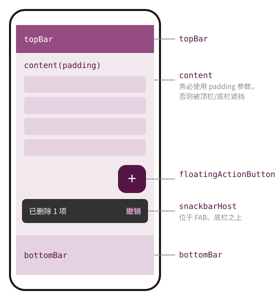

```kotlin
Scaffold(
    topBar = { TopAppBar(title = { Text("待办") }) },
    bottomBar = { NavigationBar { … } },
    floatingActionButton = {
        FloatingActionButton(onClick = onAdd) {
            Icon(Icons.Default.Add, "添加")
        }
    },
    snackbarHost = { SnackbarHost(snackbarHostState) }
) { innerPadding ->
    TodoList(Modifier.padding(innerPadding))
}
```

`Scaffold` 是 Material 3 的页面骨架，按位置提供多个"槽"。

---

### Snackbar

```kotlin
val snackbarHostState = remember { SnackbarHostState() }
val scope = rememberCoroutineScope()

Scaffold(
    snackbarHost = { SnackbarHost(snackbarHostState) }
) { padding ->
    Button(onClick = {
        scope.launch {
            val result = snackbarHostState.showSnackbar(
                message = "已删除 1 项",
                actionLabel = "撤销",
                duration = SnackbarDuration.Short
            )
            // showSnackbar 挂起直到消失，返回用户是否点了"撤销"
            if (result == SnackbarResult.ActionPerformed) viewModel.undo()
        }
    }, modifier = Modifier.padding(padding)) { Text("删除") }
}
```

---

### 对话框

```kotlin
var showDialog by remember { mutableStateOf(false) }

if (showDialog) {
    AlertDialog(
        onDismissRequest = { showDialog = false },
        title = { Text("确认删除") },
        text = { Text("删除后不可恢复，是否继续？") },
        confirmButton = {
            TextButton(onClick = { viewModel.delete(); showDialog = false }) {
                Text("删除")
            }
        },
        dismissButton = {
            TextButton(onClick = { showDialog = false }) { Text("取消") }
        }
    )
}
```

> 对话框没有 `show()` / `dismiss()`——**是否显示就是一个 Boolean 状态**。

---

### 底部弹窗与下拉菜单

```kotlin
val sheetState = rememberModalBottomSheetState()
if (showSheet) {
    ModalBottomSheet(onDismissRequest = { showSheet = false }, sheetState = sheetState) {
        Column(Modifier.padding(16.dp)) { Text("底部弹窗内容") }
    }
}
```

```kotlin
var expanded by remember { mutableStateOf(false) }
Box {
    IconButton(onClick = { expanded = true }) { Icon(Icons.Default.MoreVert, null) }
    DropdownMenu(expanded = expanded, onDismissRequest = { expanded = false }) {
        DropdownMenuItem(text = { Text("编辑") }, onClick = { expanded = false })
        DropdownMenuItem(text = { Text("删除") }, onClick = { expanded = false })
    }
}
```

> `DropdownMenu` 相对于其父 `Box` 定位，所以要和触发按钮放在同一个 `Box` 中。

---

### 反馈组件怎么选

| 组件 | 是否打断用户 | 适用场景 |
| --- | --- | --- |
| `Snackbar` | 否，几秒后自动消失 | 操作结果提示、可撤销操作 |
| `AlertDialog` | 是，必须做出选择 | 危险操作确认、重要信息 |
| `ModalBottomSheet` | 是，但可下滑关闭 | 一组操作选项、分享面板、筛选条件 |
| `DropdownMenu` | 否，点外部即关闭 | 次要操作（编辑、删除、更多） |

> 原则：能不打断就不打断。删除操作优先"直接删 + Snackbar 撤销"，而不是先弹确认框。

---

## 第六节 动画基础

- 值动画 animate*AsState
- 可见性与内容切换动画
- 动画规格 AnimationSpec

---

### animate*AsState：值动画

```kotlin
val size by animateDpAsState(
    targetValue = if (expanded) 200.dp else 100.dp,
    label = "size"
)
Box(Modifier.size(size).background(Color.Magenta))
```

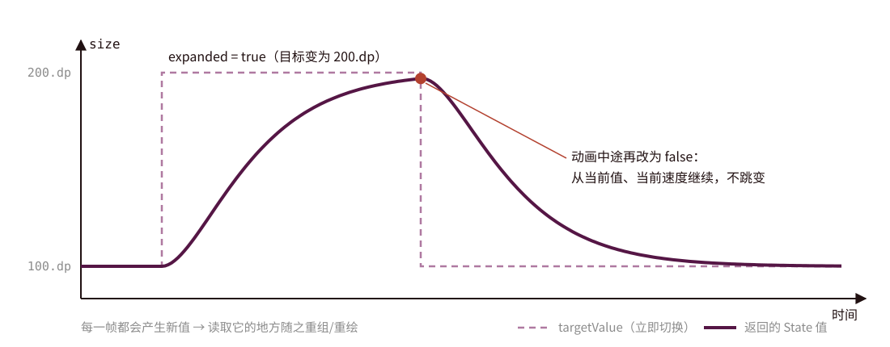

---

### 常用动画 API

```kotlin
// 单个值的动画
val color by animateColorAsState(
    targetValue = if (selected) Color.Red else Color.Gray,
    label = "color"
)
val size by animateDpAsState(if (expanded) 200.dp else 100.dp, label = "size")

// 显示/隐藏
AnimatedVisibility(
    visible = expanded,
    enter = fadeIn() + expandVertically(),
    exit = fadeOut() + shrinkVertically()
) { Text("展开的详细内容") }

// 尺寸变化
Column(Modifier.animateContentSize()) { /* 内容变化时平滑过渡 */ }

// 列表项动画
items(list, key = { it.id }) { Item(it, Modifier.animateItem()) }
```

---

### 内容切换动画

```kotlin
// AnimatedContent：目标状态变化时，旧内容退出、新内容进入
AnimatedContent(
    targetState = count,
    transitionSpec = {
        if (targetState > initialState)
            slideInVertically { it } + fadeIn() togetherWith slideOutVertically { -it } + fadeOut()
        else
            slideInVertically { -it } + fadeIn() togetherWith slideOutVertically { it } + fadeOut()
    },
    label = "count"
) { value -> Text("$value", style = MaterialTheme.typography.displayMedium) }

// Crossfade：最简单的淡入淡出切换
Crossfade(targetState = currentTab, label = "tab") { tab ->
    when (tab) { Tab.Home -> HomePage(); Tab.Me -> MePage() }
}
```

> lambda 的参数（`value` / `tab`）必须使用，不要直接读外部的 `count`，否则新旧两份内容会显示相同的值。

---

### AnimationSpec：控制"怎么动"

```kotlin
// 弹簧：基于物理，可被打断而不突兀（animate*AsState 的默认值）
animateDpAsState(target, spring(
    dampingRatio = Spring.DampingRatioMediumBouncy,   // 弹性
    stiffness = Spring.StiffnessLow                   // 刚度：越低越慢
), label = "s")

// 补间：固定时长 + 缓动曲线
animateFloatAsState(target, tween(durationMillis = 300, easing = FastOutSlowInEasing), label = "t")

// 关键帧：在指定时间点到达指定值
animateDpAsState(target, keyframes {
    durationMillis = 600
    20.dp at 100
    150.dp at 400 using LinearEasing
}, label = "k")
```


---

### 动画 API 选择

| 需求 | API |
| --- | --- |
| 一个值（颜色、尺寸、透明度、偏移）随状态变化 | `animate*AsState` |
| 组件出现 / 消失 | `AnimatedVisibility` |
| 根据状态切换不同内容 | `AnimatedContent`、`Crossfade` |
| 组件尺寸随内容变化 | `Modifier.animateContentSize()` |
| 列表项插入、删除、移动 | `Modifier.animateItem()`（需要 key） |
| 多个值随**同一个**状态一起变化 | `updateTransition` |
| 无限循环（呼吸灯、加载闪烁） | `rememberInfiniteTransition` |
| 需要手动控制（手势跟随、`snapTo`） | `Animatable` |


---

### 课堂练习

1. 实现一个待办清单：输入框 + 添加按钮 + `LazyColumn` 列表 + 勾选完成 + 删除
2. 把上题的状态提升到 `TodoViewModel`，UI 组件全部改为无状态；用 `TodoUiState` + `TodoEvent` 建模
3. 给列表加上"加载中 / 出错 / 空 / 有数据"四种状态，删除后用 Snackbar 提供"撤销"
4. 用 `AnimatedVisibility` 给"已完成项"加上折叠/展开动画，用 `animateItem()` 给增删加动画
5. 故意去掉 `items(..., key = ...)` 中的 `key`，在列表头部插入数据，观察展开状态是否错位
6. 用 `derivedStateOf` 实现"滚动超过 5 项后显示回到顶部按钮"，并用 Layout Inspector 对比使用前后的重组次数

---

## 本章小结

- **UI = f(State)**：`mutableStateOf` 让值可观察，`remember` 让它跨重组存活，`rememberSaveable` 跨重建存活
- 重组只发生在**读取了状态的作用域**，参数没变的组件会被跳过；可组合函数要快速、幂等、无副作用
- **状态提升**把状态交给调用方，组件变成无状态、可复用、可预览
- 单向数据流：状态向下、事件向上；一个屏幕一个 UI State 数据类，用 `collectAsStateWithLifecycle` 收集
- `LazyColumn` 只组合可见项；**务必传稳定唯一的 `key`**；四种列表状态缺一不可
- 副作用放进 `LaunchedEffect` / `DisposableEffect` / `rememberCoroutineScope` 等专用 API
- 反馈组件和动画同样由状态驱动：改状态，而不是调用 show/hide

---

<!-- _class: lastpage -->
<!-- _footer: "" -->

###### 参考资料

---

- [Compose 中的状态](https://developer.android.google.cn/develop/ui/compose/state)
- [状态提升的场所](https://developer.android.google.cn/develop/ui/compose/state-hoisting)
- [Compose 中的附带效应](https://developer.android.google.cn/develop/ui/compose/side-effects)
- [列表和网格](https://developer.android.google.cn/develop/ui/compose/lists)
- [Compose 性能最佳实践](https://developer.android.google.cn/develop/ui/compose/performance/bestpractices)
- [动画快速指南](https://developer.android.google.cn/develop/ui/compose/animation/quick-guide)
